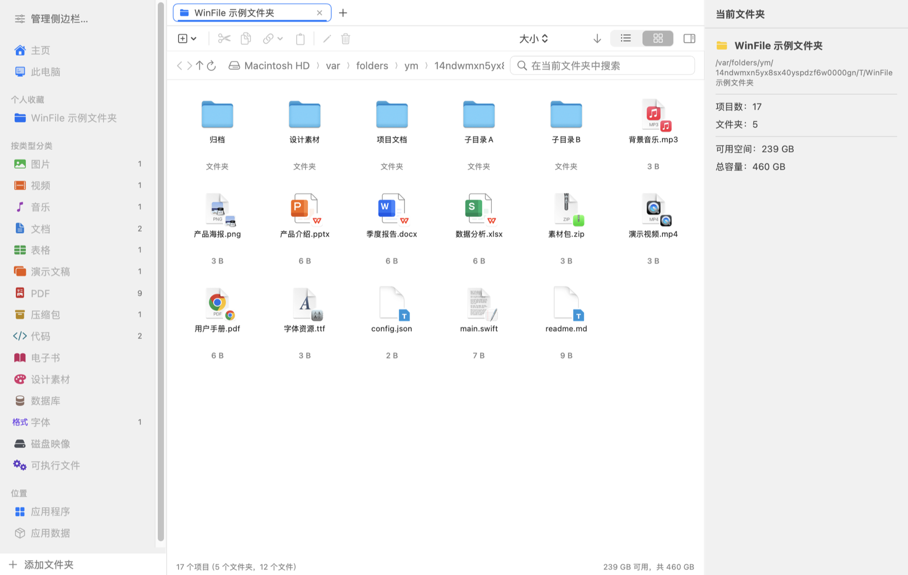

# WinFile

**A Windows Explorer–style file manager for macOS**, built with native SwiftUI.

**English** | [简体中文](README.md)

[Product website (Chinese)](https://fakeruzi.github.io/macos_winfile/) · [Latest release](https://github.com/fakerUZI/macos_winfile/releases/latest)

[](LICENSE)
[](#installation)
[](#tech-stack)
[](#testing)
[](../../releases/latest)

WinFile brings a Windows Explorer-style workflow to macOS: tabs, an editable path bar, category browsing and storage statistics in one native interface.



---

## Table of Contents

- [Why](#why)
- [Features](#features)
- [Installation](#installation)
- [Build from Source](#option-2-build-from-source)
- [Testing](#testing)
- [Project Layout](#project-layout)
- [Tech Stack](#tech-stack)
- [FAQ](#faq)
- [Known Limitations](#known-limitations)

## Why

Finder is good, but it deliberately keeps things minimal. Some everyday tasks have no direct answer there:

- Keep several tabs open in one window, each parked in a different folder
- Browse by "images / videos / documents / archives" instead of remembering which folder a file lives in
- See how much space a folder actually takes
- Find out where apps like WeChat or RedNote store their files
- Manage files on an Android tablet from your Mac

WinFile doesn't try to replace Finder — it fills those gaps. It runs **without the App Sandbox**, so it can browse the entire disk, including other apps' data containers. That's the key difference from App Store apps.

## What’s new in v1.4.0

- **Android uses MTP exclusively:** select File Transfer over USB. No USB debugging, ADB, Homebrew or extra drivers. Browse, upload, download, copy, rename and delete device files.
- **Automatic connection updates:** insertion, removal and device changes refresh without restarting. Fix reconnect identity changes and parent-folder navigation while keeping old tabs pinned to their original device.
- **Video plays from memory:** double-click for the built-in player or press Space to preview. Seeking reads the needed MTP ranges, with a shared video-data cache capped at 32 MiB and no full video file on disk. Unsupported reads or codecs report an error; downloading remains an explicit choice.
- **Other file opening and diagnostics:** reuse verified read-only local document copies, cancel stalled transfers, and retain timestamped, rotating diagnostic logs.

See the [v1.4.0 release notes](docs/releases/v1.4.0.md) and [v1.3.4 release notes](docs/releases/v1.3.4.md). Users on v1.1.0 or earlier must upgrade manually once to enable future in-app updates.

## Features

### Browsing & navigation

| Feature | Details |
| --- | --- |
| **Tabs** | Multiple tabs per window, each with its own directory, history, sort order and selection. `⌘T` to open, `⌘W` to close, right-click for "Close Others / Duplicate Tab" |
| **Path bar** | Breadcrumb of the current path; double-click to type. Supports `~`. Live suggestions while typing: `Tab` to complete, `↑↓` to move, `Enter` to go |
| **Two views** | Detail table (sortable by name / date / type / size) and a large icon grid |
| **Categories** | 15 types — images, video, music, documents, spreadsheets, presentations, PDF, archives, code, ebooks, design assets, databases, fonts, disk images, executables — each with a count badge |
| **Search** | Dedicated native search sheet with an in-app scope picker, combined name/type/extension/size/date filters, cancellation and result location in a new tab |
| **Languages** | Follows system language by default. Choose Simplified Chinese or English in Settings → General → Language; changes apply immediately and persist. Unsupported system languages fall back to English |
| **Dark mode** | Uses system semantic colors throughout, follows the system automatically |

### File operations

| Feature | Details |
| --- | --- |
| Basics | Open, rename, create folder / text file, duplicate, copy / cut / paste, drag & drop, move to Trash |
| **Compress / extract** | Compress to zip (non-ASCII names stay intact); extract ZIP, RAR (including RAR5), 7Z, TAR, standalone GZip/BZip2/XZ and compressed TAR archives. Supports passwords, volumes, batches and cancellation. Extracts into a staging directory before committing; name collisions go to a separate "<name> extracted" folder — **nothing is ever overwritten** |
| **Thumbnails** | Real previews in the icon grid: images, video poster frames, and the first page of PDFs (generated by the system QuickLook framework, cached) |
| **Open With** | Lists the apps that can actually open the file, with search filtering. You can also set a default app **inside WinFile only** — macOS associations are untouched. The associated app's icon appears in the corner of the file icon |
| **Copy as** | Copy full path / file name / parent directory. `⌘C` also writes to the system clipboard so you can paste into other apps |

### Special pages

| Page | Details |
| --- | --- |
| **Home** | Quick-access tiles, favorites, and recent files (recently modified plus files opened inside WinFile, with a marker and a way to clear the history) |
| **This PC** | Drive cards with capacity bars (orange above 75%, red above 90%), used / free / total space, filesystem type; removable volumes can be ejected |
| **Applications** | Aggregates `/Applications` and `/System/Applications` with real system icons |
| **Storage cleanup** | One entry with General cleanup and Software cleanup for caches, logs, installers, large files and WeChat chat attachments; general cleanup and other apps’ caches support undo, while WeChat attachments can be recovered from Trash |
| **App Data** | Scans app data containers so you can jump straight into another app's files (e.g. WeChat). Empty shell containers are filtered out and UUID-only entries get their real app name |
| **Android device** | Browse an Android device over built-in MTP: list, upload, download, create, rename, copy / move, delete; multiple devices are distinguished by serial number |

### Extraction

Use the context menu to extract here, into a separate folder, or to a location of your choice. Aggregated pages default to each archive's parent folder. Multiple selected archives are processed individually; completed results and per-archive failures remain visible. Cancel removes the current archive's staging data and retains previously completed archives.

Encrypted ZIP / 7Z / RAR archives prompt for a password with retry and cancel. Passwords are passed through stdin, never saved to settings or command-line arguments. Put all volumes in one folder: `.partNN.rar`, `.rar/.r00`, `.7z.001`, `.zip.001`, and `.zip/.z01` entries are recognized. Later parts resolve to the first part, and multiple selected parts of the same set are processed once. Missing volumes and damaged archives report errors.

Standalone `.gz/.bz2/.xz` streams produce the original file; `.tar.gz/.tgz`, `.tar.bz2/.tbz/.tbz2`, and `.tar.xz/.txz` are unpacked in two stages. Existing files and dangling symlinks are never overwritten. Paths are validated; extraction runs in a private directory on the destination volume with child-process writes confined to that directory. External links and path traversal are rejected. Ordinary ZIP files retain macOS metadata handling.

### Third-party engine

The app bundles the official universal macOS console [7-Zip 26.04](https://www.7-zip.org/), without requiring Homebrew or another app. 7-Zip Copyright (C) 1999–2026 Igor Pavlov. It is distributed under GNU LGPL 2.1 or later, BSD licenses and the unRAR restriction. See [provenance and source information](native/vendor/7zip/PROVENANCE.md), [license](native/vendor/7zip/License.txt), and the [corresponding source archive](https://github.com/ip7z/7zip/releases/download/26.04/7z2604-src.tar.xz). Notices are bundled with the app. Support depends on archive algorithms and encryption variants; unsupported variants report an error.

### Interface details

- **Empty-area context menu** — mirrors Windows Explorer: new folder/file, paste, sort by, view mode, show hidden files, reveal in Finder, copy current path
- **Manageable sidebar** — categories and favorites can be moved or removed from the context menu, or managed in a checkbox panel with up/down ordering
- **Add sidebar favorites directly** — right-click folders in Details or Icons view and choose **Add to Sidebar**, including multiple folders. Right-click empty space to add the current folder. Duplicates are skipped and your browsing location stays unchanged, with no system picker required. Only readable local folders are accepted; regular files, `.app` bundles, and Android paths are excluded. Favorites persist across launches; removing a shortcut leaves the folder intact. Home favorites and sidebar favorites are managed separately.
- **Status bar & inspector** — item count, total size of the selection, free disk space; the inspector shows details for a single file

### Software cleanup (new in v1.3.0)

The sidebar has one **Storage cleanup** entry with the standard text color. Inside it, choose **Software cleanup**; its unified app picker lists WeChat alongside other apps. Unresolved bundle identifiers and helper, updater and extension processes are hidden. Choose WeChat or another detected app. Supported locations include Chrome, Edge, Brave, VS Code, Slack, Discord and Teams caches, plus recognized per-app cache and log folders. Only apps with readable cleanup folders appear; refresh the list to detect new folders.

WeChat keeps its existing attachment scanner and account/month filters. Except for Baidu Netdisk downloads, other apps scan only the selected app’s identified caches and logs, keep the last seven days by default, and skip running apps. Databases, accounts, configuration, offline data and other apps’ chat attachments are preserved. Switching apps cancels the old scan and clears its results, selection and pending confirmation. Filtering, exclusions, context menus, confirmation, Trash and undo remain available. Saved tabs retain the selected app.

**Baidu Netdisk downloads:** choose Baidu Netdisk in Software cleanup to list completed local downloads separately, without the 100 MB large-file threshold or cache age limit. Common home folders (`baidu`, `BaiduNetdisk`, `百度网盘`) and Netdisk subfolders of Downloads are detected automatically. Use the built-in folder picker for a custom download location; it must be an ordinary subfolder of your home, outside Library. The selected folder is saved. No download-history/account databases or cloud files are read. Incomplete tasks, hidden files, databases, credentials, symbolic links and hard links are skipped. Nothing is preselected; quit Baidu Netdisk before confirming a move to Trash. Undo is supported. General cleanup also detects common Netdisk download folders under a separate Netdisk downloads category.

**Storage cleanup** is the last sidebar item. It contains General cleanup for cross-app scans, installers and large personal files, and Software cleanup for individual apps.

### WeChat chat attachments

Storage cards show the size and file count of all scanned attachments, the current filter, and the selection. Chat databases are excluded. Scanning reports the space discovered so far; totals update after cleanup.

Open Storage cleanup at the bottom of the sidebar, select Software cleanup, and choose WeChat. Combine filename and file-type filters with size thresholds (10 MB / 100 MB / 1 GB) and modification age (30 / 90 / 180 days). Dates refer to filesystem modification times, not message timestamps.

Select one item and click Open Containing Folder, use its context menu, or click its Folder cell to open and activate a new WinFile tab at the real directory with the file selected. The original cleanup tab retains its filters, selection and scan results. Show in Finder remains available in the context menu.

Double-click an attachment to open it with the default app, or press Space for Quick Look. Filter by account, month, and attachment/cache source; scanning reports discovered files, sizes, and the current location. The shared file context menu supports Open With, copy, cut, copying paths or names, rename, duplicate, compress/extract, Get Info and Move to Trash. File changes refresh scan results. When compressing attachments from multiple folders, choose where to save the archive. Source folder names are preserved so attachments with identical names are kept.

Scanning uses the local filesystem: discover common WeChat containers and storage folders, merge custom sources, then collect ordinary files in recognized attachment folders, which can also include caches and thumbnails. Classification uses extensions and folder names; filters use filenames, sizes and modification times. Hidden files, package contents, symbolic links, databases, configuration and log folders are skipped. The app does not read chat databases or infer contacts or send/receive direction. Attachments only on a phone or not downloaded locally are absent.

Storage layouts vary between WeChat versions. If automatic discovery finds nothing, choose the actual WeChat data or attachment folder. Added folders persist; removing a source does not delete files. If a location cannot be read, grant WinFile Full Disk Access in System Settings and rescan.

Quit WeChat before cleaning. Cleanup requires confirmation and moves selected ordinary files to Trash. Chat databases are excluded; the corresponding attachments may no longer open in WeChat. Files whose paths, sizes or modification times changed since scanning are skipped, and failures are listed individually. The feature does not decrypt attachments, read message text or group files by contact.

The cleanup page hides folder search, creation, paste and view-mode controls. Filename and type filters remain visible; account, month, source, size and age are in **Advanced Filters**. Active filters appear as removable chips and can be reset together. Click any column header to switch ascending/descending order for name, type, size, modification date or location.

Use the top-left sidebar button to hide or show the entire left menu; expanding it restores its preferred width. Drag the sidebar and inspector dividers to resize them; double-click to reset. Preferred widths persist across launches and adapt to smaller windows. File and WeChat tables remember their column widths separately.

### Tabs, search and file organization

- The tab dropdown handles overflow while keeping the active tab visible. Pin tabs through their context menu or the dropdown. Reopen up to 20 recently closed tabs during the current run with the menu or `⌘⇧T`.
- Sort order, view mode and hidden-file visibility are independent per tab. Session restore reapplies searches, size/date conditions, WeChat filters and pinned tabs. Up to 30 tabs are saved, including the active tab.
- `⌘F`, the top toolbar search button, the filter button beside folder search, or **File Organization Tools → Advanced Search** opens a dedicated WinFile search sheet. Choose the scope in-app and combine names, entry kinds, categories, extensions, sizes and modification dates. Names are optional when filters are active; date ranges include the whole selected day. Search can be limited to the current level or include subfolders and hidden files. Results support sorting, double-click opening, path copying and location in a new tab without changing the original tab’s filters.
- Select multiple local items and choose **Batch Rename** to preview replacements, prefixes, suffixes and numbering while preserving file extensions. Conflicts, invalid names and selections containing both folders and their contents are rejected. Existing files are never replaced; external conflicts trigger rollback attempts. Completed batches support `⌘Z` undo.
- **Find Duplicate Files** groups candidates by size, then hashes their complete contents with SHA-256. Symbolic links, package contents and hard links to the same file are skipped. The initial limit is 200,000 entries; cancellation, limits, unreadable files and changed files are reported. Preview results or open their containing folders in new tabs. Nothing is deleted automatically; redundant size describes logical bytes.
- WeChat storage cards and common filters remain visible. **Scan Details and Storage Breakdown** shows sources, access problems and type/month distributions. Click a group to filter it; the page also shows the last completed scan time.
- Local copies report actual byte progress. The result banner opens the destination in a new tab or retries unfinished items using the original copy/move mode, independently of subsequent clipboard changes.

### Browser memory and folder selection

The icon grid creates only visible tiles and nearby rows. Thumbnail generation is limited to four concurrent requests, with an LRU cache budget of 64 MiB, excluding images still displayed and the system Quick Look processes. Memory pressure clears cached thumbnails. Cleanup modules initialize on first use.

Local directory, search and category results outside the three most recent tabs can be released after 60 seconds idle and reread when selected. Memory pressure prioritizes inactive tabs. Operations in progress and cleanup selections are preserved.

**Open Folder** uses WinFile's built-in picker. Browse, enter paths, show hidden folders or ⌘-select multiple folders; each opens in a new tab. Extraction destinations, Android downloads, WeChat folders, duplicate scan scopes and the startup folder also use this picker. Address resolution and suggestions run off the main thread. Invalid paths retain the current location; unreadable folders have a persistent retry state.

WeChat scans initially retain up to 20,000 candidates and visit up to 200,000 entries. The page labels partial results and storage totals. Increase the limit to rescan, up to 200,000 candidates and 2,000,000 entries.

### Scan and operation feedback

- Initial searches show up to 400 results; categories show up to 800 with an initial depth of 4. Each scan checks up to 100,000 entries. Result, depth, traversal, and unreadable-location limits are reported; **Load More / Scan Deeper** expands the scan. Large folders are processed instead of skipped. Sidebar counts describe the initial scope and show `800+` when capped.
- Searches can be cancelled. Refresh preserves the query, category, and ordering. Folder entry changes trigger automatic refresh.
- A shared file clipboard works across tabs and accepts files copied in Finder. A system clipboard change invalidates an old cut.
- Local copy/move tasks show progress, cancellation, and per-item outcomes. Cancellation takes effect after the current native file operation completes. Uncommitted copy staging is removed; completed items are retained. Name conflicts keep both items.
- Command-Z undoes up to 30 rename/move operations from the current app session. Undo refuses to overwrite existing or replaced files and supports retry. Trash cleanup and permanent Android deletion are excluded.
- With no fixed startup folder, the app restores the last window's tabs, active folder, ordering, and layout (up to 30 tabs). A configured startup folder takes precedence; missing paths fall back to Home.
- Folder sizes count logical bytes of ordinary files, including hidden contents, without following symlinks. Totals are marked partial if the initial 200,000-entry budget is reached, cancelled, or locations cannot be read. The budget can be expanded.
- Android deletion is permanent and requires an explicit confirmation at every entry point.

## Storage cleanup (new in v1.3.0)

Choose **Storage cleanup** at the bottom of the sidebar, select **General cleanup**, then start a scan. Review supported app caches and logs, installers in Downloads/Desktop, and large files in personal folders. Each category can be scanned separately. Browser rules target explicit cache locations and preserve profiles, databases and offline state. ZIP contents are inspected to distinguish installers from ordinary archives.

General cleanup also lists WeChat attachments under the WeChat source, without a minimum size or cache age limit. It reuses the dedicated scanner’s attachment rules and the custom folders saved in the WeChat page, without reading or decrypting chat databases. Attachments are scanned before high-volume caches and Netdisk downloads. If a combined scan reaches its limit, choose WeChat attachments in Scan settings. Scanning works while WeChat is running; quit WeChat before confirming cleanup. File identity and open-file checks still apply, and successful moves from General cleanup support `⌘Z` undo. Account and month filters remain available in Software cleanup → WeChat.

Sources use readable app names. Helpers with a confirmed parent app are grouped under that app; unidentified sources appear under Other apps instead of raw bundle identifiers. Personal folders retain their directory names. Actual file paths and cleanup revalidation remain intact.

Caches, logs and installers from the last 7 days are kept by default; the large-file threshold is 100 MB. Nothing is preselected. Filter by source, category or path, sort results, and review 200 rows per page with selection preserved across pages. Double-click to open; the context menu includes preview, copying paths, opening the containing folder in a new tab, and exclusions.

Before each move, WinFile rechecks file and parent identities, metadata, running applications and open-file state. Inconclusive checks keep the file. Confirmed files go to Trash, with session undo using `⌘Z`; cleanup never elevates privileges or empties Trash. Exclusions and the last 30 cleanup summaries stay on this Mac. Moving to Trash does not immediately free space, and APFS sharing makes disk usage an estimate. Cancellation, limits and inaccessible paths are reported as incomplete scans.

## Installation

### Requirements

| Item | Requirement |
| --- | --- |
| OS | macOS 13 (Ventura) or later |
| Architecture | Apple Silicon or Intel (universal binary) |
| Android | Bundled MTP; select USB File Transfer on the phone |
| Building from source (optional) | Xcode Command Line Tools — `xcode-select --install` |

A full Xcode install is not required, and neither is a paid Apple Developer account.

### One-command install (recommended)

Quit WinFile and paste this into Terminal:

```bash
curl -fsSL https://raw.githubusercontent.com/fakerUZI/macos_winfile/main/install.sh | /bin/bash
```

Downloads the latest universal release for Apple Silicon and Intel; no Xcode or Homebrew required. The [installer](install.sh) checks SHA-256 and the bundle signature, installs into `/Applications`, preserves the previous app and leaves preferences intact. Failed replacement rolls back. If that directory is not writable, download the script and run `bash install.sh --dir "$HOME/Applications"`. Use `--no-open` to install without launching. Android uses bundled MTP; no extra tools or USB debugging are required.

See the [v1.1.0 release notes](docs/releases/v1.1.0.md) for WeChat Cleanup, Android browsing, RAR/7Z extraction and other improvements.

### Option 1: Download the release

Download `WinFile.zip` from [Releases](../../releases/latest), unzip it, and drag `WinFile.app` into Applications.

The current release is ad-hoc signed and has not been notarized with a Developer ID. If macOS blocks a browser download, first check the provided `WinFile.zip.sha256`, then follow the allow-opening steps in System Settings → Privacy & Security. Do not proceed with an unexpected source or a mismatched checksum.

### Option 2: Build from source

Builds produced on your own machine **don't carry the quarantine flag**, so the block above doesn't apply.

```bash
git clone https://github.com/fakerUZI/macos_winfile.git
cd macos_winfile

./native/build_native.sh            # build and install to /Applications
./native/build_native.sh --in-place # build into the project folder only
```

The build script generates the icon, compiles for arm64 and x86_64, merges them into a universal binary, assembles the app bundle, copies localizations, signs it (ad-hoc when no identity is available), then installs and registers it.

The first build downloads and verifies the pinned Sparkle SDK, then embeds the update framework. Release packaging uses the verified build in the system temporary directory; the project’s `WinFile.app` is a convenience copy.

### In-app updates (from v1.2.0)

WinFile checks GitHub’s latest stable release on each launch. The native update window offers Install Update, Skip This Version and Remind Me Later. After downloading and verifying the update, confirm installation and relaunch; active file operations finish before restarting. Disable launch checks in General settings or check manually from the app menu or Settings → About.

Users on v1.1.0 or earlier must upgrade to v1.2.0 (or later) manually once. See the [update and release workflow](docs/automatic-updates.md) and [v1.2.0 release notes](docs/releases/v1.2.0.md) for signing and release assets.

### Android setup


1. Unlock the phone and connect it to the Mac with a USB data cable.
2. Select **File Transfer / Android Auto** in the phone’s USB settings and allow file access if prompted.
3. WinFile automatically shows the device and its exposed storage. Reconnecting does not require restarting WinFile.

The app bundles dynamically linked libmtp 1.1.23 and libusb 1.0.30 in both architectures. It uses MTP exclusively, without ADB, Homebrew or USB debugging. A separate helper isolates USB operations and enforces timeouts. Close other MTP applications if they have claimed the device.

Browsing, creation, renaming, upload, download, copying and deletion are supported. Moving within the phone requires device support; unsupported moves report an error without deleting the source. Copies download through a temporary Mac folder and upload through MTP, requiring local disk space. Uploads and downloads refuse to overwrite existing names; uploads do not follow symbolic links.

Only files exposed by the phone are visible. App-private data, `Android/data` and system folders may be restricted. This does not mount the complete Android filesystem.

### Adding sidebar favorites

Drag folders from WinFile’s detail list, icon view, or Finder into the sidebar. The highlighted area adds shortcuts without copying or moving the originals. Existing folders are deduplicated; regular files and application bundles are rejected.

The Add Folder actions in the sidebar, its context menu, Manage Sidebar, and Settings use WinFile’s own folder picker. Double-click to browse, enter a path (including `~`), go up, show hidden folders, filter the current directory, or select multiple sibling folders with ⌘. Cancelling leaves the browsing tab unchanged.

### Android connection updates and opening files

Device insertion, removal and File Transfer readiness update automatically. A disconnected folder remains in its tab and reloads after reconnection and selecting File Transfer.

Videos open in the built-in player using MTP range reads and a shared RAM cache capped at 32 MiB. Double-click or choose Open to play; Space previews the video. Seeking reads the required ranges without creating a full video file on disk. Closing the player or changing the device connection cancels reads and releases the cache. Unsupported device reads or video encodings report an error without automatically downloading the file. Select one video at a time; use Download explicitly for external players.

Other files download a verified, read-only local copy for the default Mac application or Quick Look, with progress and cancellation. These copies are cached by device, path, MTP object identity, size and modification time; edits are never uploaded to Android. Save As or download to a normal folder for editing. This disk cache targets 2 GiB and removes copies older than seven days when preparing files. Copies opened in the current WinFile session are retained for external applications and may exceed that target. Files manually downloaded to a chosen folder are never automatically removed.

## Testing

```bash
./native/run_native_tests.sh
```

Add `--skip-device-tests` to skip real-device file operations and browsing when an Android device is connected.

Runs three modes in sequence: command-line logic tests → tests inside the real app bundle → UI smoke tests. If an MTP-ready Android device is connected, it also runs real device file operations.

v1.4.0 feature validation: **1,149 logic checks**, **1,179 connected-device checks**, and **1,184 app-bundle checks including real video playback**, all passing; **53 independent MTP helper protocol checks** passed on retry. Real-window checks covered playback, seeking, paused Space previews, unsupported-video feedback and device file operations. Physical files over 4 GiB and every device brand were not covered. See the [v1.4.0 release notes](docs/releases/v1.4.0.md) and [MTP video QA record](docs/qa/2026-10-22-mtp-streaming.md).

Regression coverage includes invalid mouse coordinates during app switching (NaN, infinity, and out-of-bounds values), event-monitor cleanup, and normal double-click behavior. See the [app-switch crash analysis and fix](docs/bugfixes/app-switch-crash.md).

The app binary itself also exposes a test entry point:

```bash
./WinFile.app/Contents/MacOS/WinFile --run-tests
```

## Project Layout

```
macos_winfile/
├── native/
│   ├── WinFile/                        # SwiftUI sources
│   │   ├── WinFileApp.swift            #   entry point, menu bar, commands
│   │   ├── MainView.swift              #   main UI (sidebar / tabs / toolbar / path bar / inspector)
│   │   ├── LayoutPreferences.swift     #   pane sizing and table column persistence
│   │   ├── PaneResizeHandle.swift       #   draggable dividers and accessibility
│   │   ├── SidebarView.swift           #   navigation sidebar (context menu move / remove)
│   │   ├── SidebarManagerSheet.swift   #   sidebar management panel (checkboxes + ordering)
│   │   ├── SidebarPreferences.swift    #   category visibility and order (persisted)
│   │   ├── FileViews.swift             #   detail table, icon grid, icons and badges
│   │   ├── InspectorView.swift         #   details pane
│   │   ├── HomeViews.swift             #   Home / This PC
│   │   ├── TabManager.swift            #   tab management
│   │   ├── BrowserSession.swift        # saved tabs and session restoration
│   │   ├── FileClipboard.swift         # shared tabs / system clipboard
│   │   ├── FileTransferService.swift   # transfer progress, cancellation and results
│   │   ├── FileOperationHistory.swift  # undo rename and move
│   │   ├── FileSearchCriteria.swift    # type / extension / size / date search filters
│   │   ├── FileSearchModel.swift       # independent search, progress, cancellation and limits
│   │   ├── FileSearchSheet.swift       # native search sheet and result actions
│   │   ├── BatchRenameService.swift    # batch rename preview, rollback and undo
│   │   ├── DuplicateFileService.swift  # content hashes and duplicate groups
│   │   ├── OrganizingSheets.swift      # file organizing tool sheets
│   │   ├── QuickLookService.swift      # Space preview
│   │   ├── DirectoryWatcher.swift      # directory change monitoring
│   │   ├── ActiveTabReader.swift       #   binds the UI to the active tab's model
│   │   ├── ContextMenuCatcher.swift    #   empty-area context menu (AppKit hit testing bridge)
│   │   ├── Dialogs.swift               #   rename / new item / open with
│   │   ├── SettingsView.swift          #   settings (general / sidebar / open with / diagnostics)
│   │   ├── PathField.swift             #   path field with Tab completion
│   │   ├── Models.swift                #   item model and file type database
│   │   ├── FileSystemService.swift     #   stateless file I/O (background-friendly)
│   │   ├── ArchiveService.swift        #   compression / extraction
│   │   ├── ArchiveExtraction.swift     #   passwords, volumes, staging and cancellation
│   │   ├── ThumbnailService.swift      #   QuickLook thumbnails (images / video / PDF)
│   │   ├── FileAssociations.swift      #   default open-with inside the app only
│   │   ├── DefaultAppService.swift     #   associated-app resolution and badge icon cache
│   │   ├── FSEngine.swift              #   favorites, icons, Trash, Launch Services
│   │   ├── AppDataService.swift        #   app data container scanning
│   │   ├── AppDataView.swift           #   app data page
│   │   ├── WeChatCleanupService.swift  # attachment scanning and cleanup
│   │   ├── WeChatCleanupModel.swift    # filters and scan state
│   │   ├── WeChatCleanupView.swift     # WeChat cleanup page
│   │   ├── BrowserModel.swift          #   browsing state (navigation / sort / selection / clipboard)
│   │   └── Android/                    #   Android device support (MTP)
│   ├── WinFileTests/                   # logic tests, UI snapshots and smoke tests
│   ├── Resources/                      # Chinese / English localizations
│   ├── Info.plist                      # app metadata
│   ├── build_native.sh                 # build script
│   ├── run_native_tests.sh             # test script
│   └── make_release.sh                 # release packaging script
├── docs/                               # icon and screenshots
├── tools/make_icon.py                  # icon generation (called during build)
├── LICENSE
└── README.md
```

Build artifacts (`WinFile.app/`) and release packages (`dist/`) are not committed — the scripts regenerate them.

## Tech Stack

| Area | Approach |
| --- | --- |
| UI | SwiftUI (`NavigationSplitView` / `Table` / a hand-rolled grid), AppKit for menus, clipboard, and Launch Services bridging |
| File I/O | `FileManager` + `URLResourceKey`; write operations run on background threads |
| Compression | System `zip` / `ditto` and bundled universal `7zz` |
| Thumbnails | QuickLook (`QLThumbnailGenerator`) for images, video posters, and PDF first pages |
| Icons | `NSWorkspace.icon(forFile:)`, preserving system icons including those inside Assets.car |
| Android | libmtp + libusb through a separate MTP helper |
| Localization | `Localizable.strings` (Simplified Chinese / English) with inline fallbacks in code |
| Build | Direct `swiftc` invocation, no Xcode project; `lipo` produces the universal binary |

## FAQ

**Why does macOS say the app is damaged?**

The app has no Apple Developer signature and isn't notarized, so macOS blocks it. The file isn't damaged — clear the quarantine flag once as shown in [Installation](#option-1-download-the-release).

**Why isn't this on the App Store?**

The App Store requires the App Sandbox, which would **permanently block** reading other apps' data containers — one of this project's core features. Publishing would also require a paid developer account (USD 99/year). So WinFile targets local use.

**Does Android access require USB debugging?**

No. Version 1.4.0 and later use MTP exclusively. Select File Transfer on the phone; installing ADB is unnecessary.

**Why do some system folders show "no permission"?**

macOS protects certain directories with TCC (e.g. Safari's container). Even with Full Disk Access granted, a few remain unreadable — that's a system limitation.

**Does changing the default app affect macOS?**

No. Defaults set inside WinFile are stored only in WinFile's own preferences and never call system-level association APIs. Finder and other apps keep their existing behavior.

## Known Limitations

| Item | Notes |
| --- | --- |
| First-launch block | Ad-hoc signed, not notarized; browser downloads may need approval through macOS settings |
| Android | Unlock the phone and select USB File Transfer; visible content depends on the device |
| System folders | A few TCC-protected directories stay unreadable |
| Not implemented | Tag colors, network locations (SMB/FTP) |

If this project helps you, a star is appreciated. Issues and suggestions are welcome.

### Tab switching and view reuse

The shared bars and sidebar stay mounted while switching tabs. Up to three recently used content views are reused to preserve native tables, icons and scroll state; closing a tab releases its view. Tabs outside that cache keep their browser models and rebuild their content on demand. Active-model refresh bursts are coalesced, and inactive tabs do not refresh the active page. Diagnostics are written in the background; normal use does not log every tab render.
