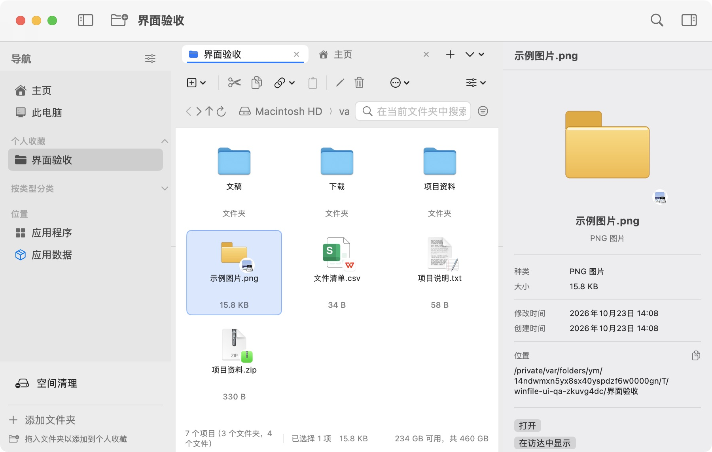
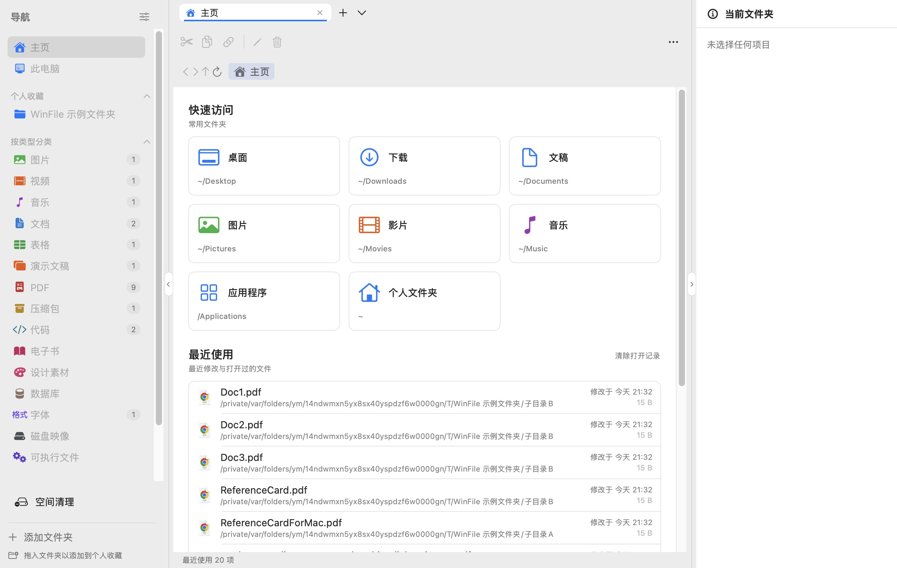
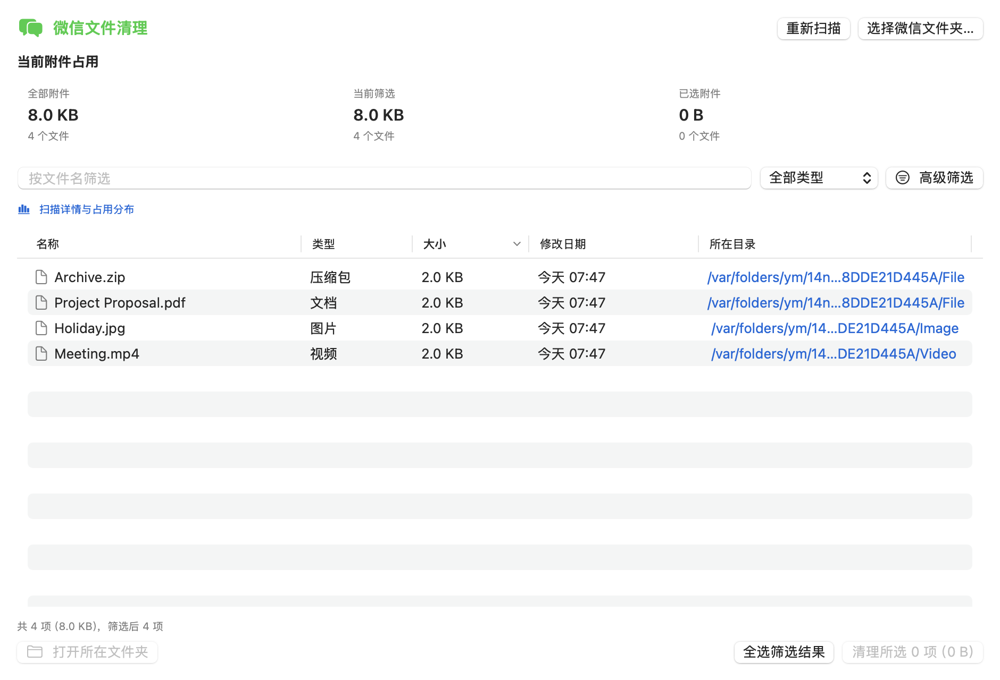
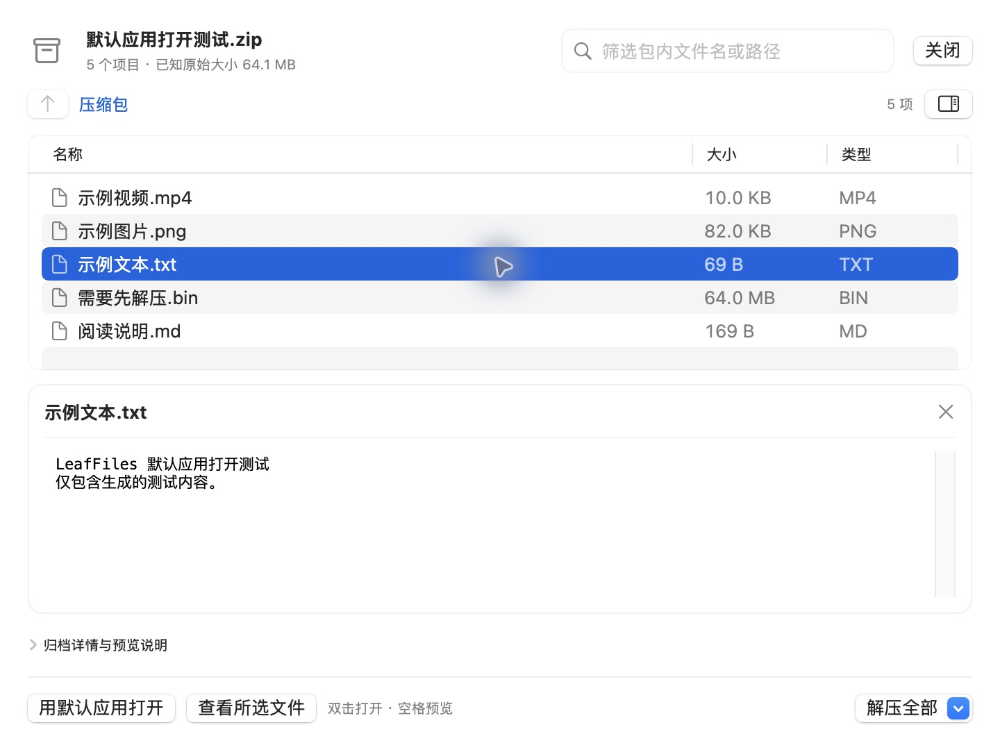
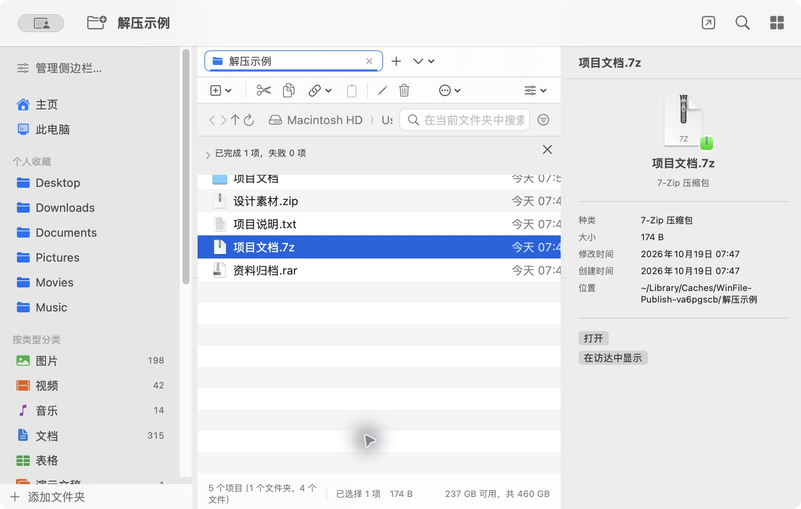
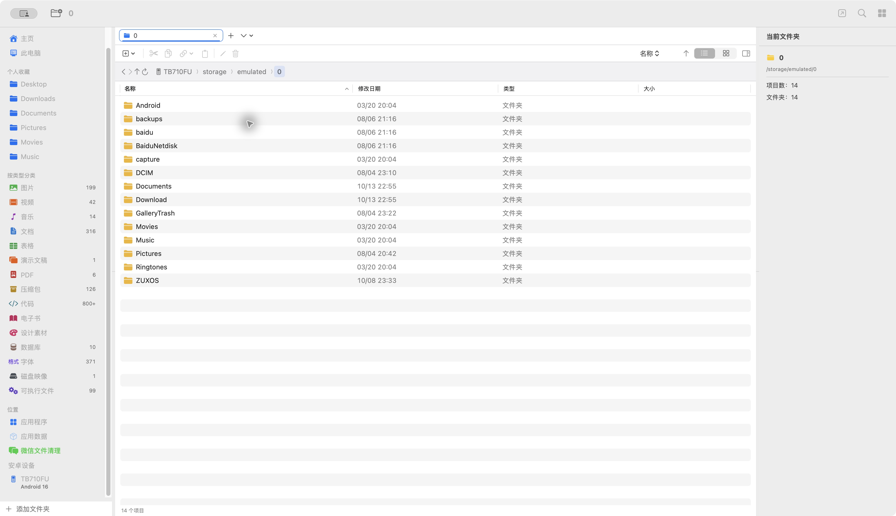

# LeafFiles

**让 Mac 文件管理更顺手**：原生 macOS 文件管理器，集成多页签浏览、安卓 MTP、压缩包预览与空间清理。

[English](README.en.md) | **简体中文**

[产品官网](https://fakeruzi.github.io/macos_winfile/) · [下载最新版](https://github.com/fakerUZI/macos_winfile/releases/latest)

[](LICENSE)
[](#安装)
[](#技术栈)
[](#测试)
[](../../releases/latest)

LeafFiles 面向日常文件浏览与整理：在多页签间切换目录，通过路径栏和分类查找文件，在同一界面查看空间占用、整理应用附件与管理安卓设备。支持简体中文、English 和 macOS 深色模式。



---

## 目录

- [为什么做这个](#为什么做这个)
- [项目状态与维护方向](#项目状态与维护方向)
- [功能](#功能)
- [安装](#安装)
- [从源码构建](#方式二从源码构建)
- [测试](#测试)
- [项目结构](#项目结构)
- [技术栈](#技术栈)
- [常见问题](#常见问题)
- [已知限制](#已知限制)

## 为什么做这个

LeafFiles 面向这些日常整理需求：

- 想在一个窗口里开多个页签，各自停在不同目录
- 想按「图片 / 视频 / 文档 / 压缩包」直接浏览，而不是先记得文件在哪个文件夹
- 想知道某个文件夹到底占了多少空间
- 想看看微信、小红书这些应用把文件存在了哪
- 想在 Mac 上管理安卓平板里的文件

LeafFiles 将这些操作集中在一个原生 macOS 界面中，文件扫描与整理在本机进行。应用**未启用 App Sandbox**，可浏览 macOS 权限允许的目录，包括可读取的应用数据目录。

## 项目状态与维护方向

截至 2026 年 10 月 26 日，近期修复已完成回归验证，当前本机使用中暂未发现明显问题。LeafFiles 会继续围绕文件浏览、整理和管理打磨体验，后续以界面优化、性能提升和问题修复为主，不扩展与文件管理无关的功能。使用中遇到问题，欢迎通过 [Issues](https://github.com/fakerUZI/macos_winfile/issues) 反馈。

## 本次更新：v2.2.0

- **图标配色**：恢复侧栏导航与分类图标颜色，主页快速访问同步使用蓝色常用目录、绿色图片、橙色影片与紫色音乐图标。
- **侧栏原位收起与展开**：左右分隔线增加方向箭头；收起后在边缘保留反向箭头，展开恢复之前的宽度，仍支持拖动调宽、双击复位与顶部按钮。
- **修复目录切换闪现**：列表与网格首帧使用 macOS 文件夹图标，消除黄色占位图闪现，同时保留自定义图标加载。
- 继续围绕文件管理优化界面、性能和稳定性；已有社区贡献者致谢保留。

[完整更新记录](docs/releases/v2.2.0.md) · [发行验收记录](docs/qa/2026-10-26-release-2.2.0.md) · [v2.1.0 更新记录](docs/releases/v2.1.0.md) · [一键安装](#一键安装推荐)



## 功能

### 浏览与导航

| 功能 | 说明 |
| --- | --- |
| **多页签** | 一个窗口内多个页签，各自独立的目录、历史、排序与选择；支持 `⌘T` 新建、`⌘W` 关闭、右键「关闭其它 / 复制标签页」 |
| **路径栏** | 面包屑显示当前路径，双击可输入；支持 `~`；输入时实时给出候选，`Tab` 补全、`↑↓` 选择、`Enter` 跳转 |
| **两种视图** | 详细信息表格（可按名称/日期/类型/大小排序）与大图标网格 |
| **按类型分类** | 图片、视频、音乐、文档、表格、演示文稿、PDF、压缩包、代码、电子书、设计素材、数据库、字体、磁盘映像、可执行文件，共 15 类，带数量徽标 |
| **搜索** | LeafFiles 独立搜索弹窗，应用内选择范围，组合名称、类型、扩展名、大小和日期；支持取消扫描及新页签定位 |
| **中英双语** | 默认跟随系统语言，也可在「设置 → 通用 → 语言」选择简体中文或 English，立即生效并保存；其它系统语言回退英文 |
| **深色模式** | 全部使用系统语义颜色，自动跟随 |

### 文件操作

| 功能 | 说明 |
| --- | --- |
| 基础操作 | 打开、重命名、新建文件夹 / 文本文档、制作副本、复制 / 剪切 / 粘贴、拖放、移到废纸篓 |
| **压缩 / 解压** | 压缩为 zip（中文文件名不乱码）；解压 ZIP / ZIPX / RAR（含 RAR5）/ 7Z / TAR、CAB / ARJ / LZH / LHA / CPIO / AR / DEB / RPM / XAR，以及 GZip / BZip2 / XZ / Zstandard / LZMA / Unix compress 单文件和 TAR 组合格式；支持包内预览、密码、分卷、批量解压和取消，先解到暂存目录再移入目标，同名冲突自动改名为「\<包名\> 解压」，**全程零覆盖** |
| **缩略图** | 大图标视图下显示真实预览：图片、视频封面帧、PDF 首页（由系统 QuickLook 生成，带缓存） |
| **打开方式** | 列出系统里真正能打开该文件的应用，支持搜索过滤；可在应用内指定默认应用（**不影响 macOS 系统关联**）；文件图标右下角显示关联应用徽标 |
| **复制为** | 复制完整路径 / 文件名 / 所在目录；`⌘C` 同时写入系统剪贴板，可直接粘贴到其它应用 |

### 特色页面

| 页面 | 说明 |
| --- | --- |
| **主页** | 快速访问磁贴、收藏夹、最近使用（最近修改 + 应用内打开过的文件，带标记，可清除记录） |
| **此电脑** | 驱动器卡片，带容量进度条（>75% 变橙、>90% 变红）、已用 / 可用 / 总容量、文件系统类型；可移动盘可弹出 |
| **应用程序** | 聚合 `/Applications`、`/System/Applications`，使用系统真实图标 |
| **空间清理** | 一个入口，包含「通用清理」和「软件清理」；支持缓存、日志、安装包、大文件及微信聊天附件，提供占用统计、筛选、忽略和预览确认；通用清理与其他软件缓存支持撤销，微信附件可从废纸篓恢复 |
| **应用数据** | 扫描各应用的数据容器，快速进入其它应用（如微信）的文件目录；自动去掉空壳容器并还原真实应用名 |
| **安卓设备** | 通过内置 MTP 浏览安卓设备：列表、上传、下载、新建、重命名、复制 / 移动、删除，多台设备按序列号区分 |

### 通用空间清理（v1.3.0 新增）

点击侧边栏最下方「空间清理」，在「通用清理」中点击「开始扫描」。可扫描常见应用的缓存与日志、下载和桌面中的安装包，以及个人文件夹中的大文件；也可单独扫描某一类别。浏览器只检查明确的缓存位置，保留配置、数据库与离线数据。ZIP 会检查内容，普通资料压缩包不会归为安装包。

通用清理也会展示「微信附件」，来源显示为「微信」，不限附件大小或保留时间。它复用微信专用页的附件识别规则，以及在微信页保存的自选目录；不读取或解密聊天数据库。微信附件优先扫描，避免被大量缓存或网盘文件挤出候选上限。若总扫描仍达到上限，可在「扫描设置 → 本次扫描」中单独选择「微信附件」。微信运行时可以扫描查看，清理前需退出微信，且仍需确认、文件身份和占用检查；通用清理中的成功移动支持 `⌘Z` 撤销。账号、月份等细分筛选仍在「软件清理 → 微信」中提供。

应用来源统一显示可读的软件名；可确认归属的辅助程序合并至主应用，无法识别的来源归入「其他应用」，不再单独展示原始 bundle 标识。个人文件夹来源保留目录名，真实文件路径与清理前校验仍保持原样。

默认保留最近 7 天的缓存、日志与安装包，大文件阈值为 100 MB。扫描只列出候选，默认不选择任何文件；支持应用/来源、路径、类别筛选、稳定排序、200 行分页与跨页选择。双击可打开，右键可预览、复制路径、在新页签定位，以及忽略文件或所在目录。

清理前会复查文件及父目录身份、大小与修改状态，运行中应用、被占用文件及无法确认状态的文件会保留。只将确认的文件移入废纸篓，不提权、不清空废纸篓；成功移动可在当前会话用 `⌘Z` 撤销。忽略列表和最近 30 条清理摘要仅保存在本机。移入废纸篓不会立即释放空间，磁盘占用受 APFS 共享块影响，仅作估算。扫描达到上限、取消或无权限时会明确提示结果不完整。

### 软件清理（v1.3.0 新增）

侧边栏仅保留默认文字颜色的「空间清理」入口；进入后选择「软件清理」，使用统一的软件选择器，微信与其他软件同级展示；隐藏未解析的原始 bundle 标识以及辅助、更新和扩展子程序。可选择微信或本机检测到的其他软件，例如 Chrome、Edge、Brave、VS Code、Slack、Discord、Teams，以及具有可识别缓存或日志目录的软件。列表依据实际可读取目录生成，可手动刷新；未检测到清理目录的软件不会列出。

微信使用原有的聊天附件扫描、账号和月份筛选。除百度网盘下载文件外，其他软件仅处理所选软件的明确缓存和日志，默认保留最近七天，运行中的软件会跳过；不清理其他软件的聊天附件、账号、数据库、配置或离线资料。切换软件会取消旧扫描并清空旧结果、选择和清理确认。支持筛选、忽略、右键、预览确认、废纸篓与撤销；页签恢复会保留所选软件。

**百度网盘下载文件**：在「软件清理」中选择「百度网盘」，单独列出本机已完成下载的文件，不受 100 MB 大文件阈值和七天缓存保留期限制。自动识别个人文件夹下的 `baidu`、`BaiduNetdisk`、`百度网盘`，以及下载文件夹内的 `BaiduNetdisk`、`百度网盘` 子目录；可用 LeafFiles 内置目录选择器指定实际下载目录并保存。自选目录沿用个人文件夹内普通子目录的限制。不会读取网盘下载记录或账号数据库，不扫描云端文件。未完成任务、隐藏文件、数据库、凭据、符号链接和硬链接会跳过；下载资料默认不勾选，清理前需退出百度网盘，确认后移到废纸篓，可撤销。通用清理也会识别常见网盘下载目录，并支持「网盘下载文件」类别。

「空间清理」位于侧边栏最后一项，统一提供「通用清理」和「软件清理」两个子范围；通用清理用于跨软件扫描、安装包和个人大文件整理。

### 微信聊天附件



*界面截图使用示例附件，不包含真实聊天内容。*

页面顶部展示全部附件、当前筛选和已选附件的占用空间及文件数。统计仅包含已扫描的本机附件，不包含聊天数据库；扫描时显示已发现附件的实时占用，清理后自动更新。

点击侧边栏底部「空间清理」，切换到「软件清理」并选择「微信」即可扫描本机附件。支持文档、图片、视频、音频、压缩包和其它附件；可按 10 MB / 100 MB / 1 GB、30 / 90 / 180 天以前及文件名组合筛选。时间筛选依据文件修改时间，不解析聊天记录中的发送时间。

选中一项后，点击下方「打开所在文件夹」，或右键文件选择同名菜单，会在 LeafFiles 中新建并激活页签，进入实际目录并选中文件；点击「所在目录」列也使用新页签。原清理页保留筛选、选择和扫描结果，切回原页签即可继续整理。右键「在访达中显示」仍可使用。

支持双击用默认应用打开附件，空格快速预览；压缩包默认使用内置包内预览，已指定的自定义打开方式优先；右键菜单与普通文件页共用，提供打开方式、复制、剪切、复制路径或文件名、重命名、制作副本、压缩与解压、显示简介和移到废纸篓。重命名、制作副本、压缩与解压后自动刷新扫描结果；多目录附件合并压缩时可选择保存位置，压缩包保留来源目录名，允许不同目录存在同名文件。

扫描以本地文件系统为依据：自动发现微信容器与常见存储位置，合并手动添加的位置，递归识别附件目录中的普通文件，也可能包含缓存和缩略图。根据扩展名和目录名分类，按修改时间、文件大小及名称筛选；跳过隐藏文件、应用包内部、符号链接、数据库、配置与日志目录。不读取聊天数据库，不推断联系人或发送/接收方向，手机端独有或尚未下载到本机的附件不会显示。

微信不同版本的存储结构可能不同。未自动找到时，使用「选择微信文件夹…」添加实际数据目录或附件文件夹；手动添加的目录会保存，移除入口不会删除文件。若提示某些目录不可读，可在系统设置中为 LeafFiles 开启完整磁盘访问权限后重新扫描。

清理前建议退出微信。操作需要确认，只将所选普通文件移到废纸篓，不清理聊天数据库；对应附件可能因此无法在微信中打开。清理前会重新检查路径、大小和修改时间，已变化的文件会跳过，失败项会逐项显示。此功能不解密附件或读取聊天文本，也不按联系人分组。

微信页隐藏不适用的目录搜索、新建、粘贴及视图切换工具。常用文件名、类型筛选直接显示；账号、月份、来源、大小和时间位于「高级筛选」。已启用条件显示为可单独移除的标签，也可一键重置；点击表头按名称、类型、大小、修改日期或所在目录切换升降序。

左上角的侧边栏按钮可隐藏或重新展开整个左侧菜单，展开后保留原有宽度。侧边栏和详细信息窗格可拖动分隔条调整宽度，双击恢复默认，重启后记住首选宽度；窄窗口自动为内容留出空间。普通文件列表与微信列表分别记忆用户调整的列宽。

### 页签切换与视图复用

页签切换保留公共栏和侧边栏，并复用最近使用的最多 3 个页签内容视图，减少表格、图标和滚动状态的重复创建；关闭页签时释放对应视图。超过最近 3 个页签范围且闲置至少 60 秒的本地文件列表，会释放可重新读取的目录、搜索和分类条目，切回时按原目录和筛选条件读取；内存压力下优先回收非活动页签。进行中的操作与清理选择不受回收影响。当前模型的刷新通知会合并，非活动页签不触发活动页重绘；诊断日志在后台写入，普通使用不记录每次页签重绘。

大图标网格使用原生滚动容器，只创建可见区域及附近的磁贴；有限的行宿主池复用文字、图标控件，避免滑动时反复建立整片 SwiftUI 布局。系统文件图标按文件、版本与尺寸缓存，最多并发加载 2 个，缓存预算 12 MiB；没有默认打开应用的文件类型也缓存查询结果，避免滚动时反复查询系统。缩略图最多并发生成 4 张，按最近使用顺序回收，缓存预算为 64 MiB（不含仍在显示的图片和系统 Quick Look 进程）；内存压力下清空两类图片缓存。清理模块首次访问时才初始化。

「打开文件夹」使用 LeafFiles 内置选择器，可输入路径、显示隐藏目录并用 ⌘ 多选，每个目录在新页签打开。解压位置、安卓下载位置、微信目录、重复文件扫描范围和启动目录也使用内置选择器。地址输入与补全在后台读取；无效路径不会误跳到父目录，读取失败页面可重试。

微信扫描默认最多保留 20,000 个候选、遍历 200,000 个条目；达到上限后明确标注部分结果与部分占用统计，可手动提高上限重新扫描（最高 200,000 个候选、2,000,000 个条目）。

### 扫描与操作反馈

- 搜索初次显示最多 400 项，分类初次显示最多 800 项、扫描到第 4 层；每轮最多检查 100,000 个条目。达到结果、深度或遍历限制时明确提示，可点击「继续加载 / 深入扫描」扩大范围。大目录不再整体跳过，无法读取的位置单独计数；侧边栏徽标表示初始扫描范围，封顶显示 `800+`。
- 搜索可取消；刷新保留查询、分类和排序。目录中的新增、删除及重命名会触发自动刷新。
- 复制 / 剪切 / 粘贴跨页签共享，也支持从访达复制文件。系统剪贴板改变后，旧的剪切失效。
- 本地复制 / 移动显示进度、支持取消，并保留成功与失败明细。复制可在当前文件传输中取消，移动在当前项目完成后停止；未提交的复制暂存内容会清除，已完成的项目保留。同名默认保留两者。
- `⌘Z` 可撤销当前应用会话中的重命名和移动，保留最近 30 次操作；撤销遇到同名或文件被替换时拒绝覆盖并允许重试。废纸篓清理和安卓永久删除不在此撤销范围内。
- 启动位置留空时，重启恢复上次窗口的页签、活动目录、排序和视图（最多 30 个页签）；明确设置启动文件夹时优先使用该设置。失效路径回到主页。
- 文件夹大小按普通文件的逻辑字节数计算，包含隐藏内容且不跟随符号链接。默认统计最多 200,000 项；无法读取、取消或达到上限时标注「部分统计」，可继续扩大范围。
- 安卓设备插拔、锁屏与文件传输就绪状态自动更新，无需重启；断开时保留当前目录并显示状态，重新连接并选择文件传输后自动读取。
- 安卓图片和 PDF 双击、右键打开默认使用应用内 Quick Look，避免启动 macOS「预览」后，相机导入进程独占 MTP 的 USB 接口。普通文档仍交给默认应用，手动下载的图片可自行用外部应用打开；本地文件关联不受影响。
- 安卓视频双击或右键打开、空格预览使用内置播放器：MTP 按需分段读取，支持拖动进度，共享 RAM 缓存上限 32 MiB，不创建完整视频磁盘副本。关闭播放窗口或设备连接变化时取消读取并释放缓存；设备分段读取或视频编码不兼容时明确提示，不自动退回完整下载。外部播放器需要自行使用「下载」保存；一次打开一个视频。
- 其他安卓文件先下载到本机只读缓存，校验后交给默认应用或 Quick Look，显示下载进度并支持取消。缓存按设备、路径、对象身份、大小和修改时间区分，不会把修改回传到设备；需要编辑请另存为或下载到普通目录。此类磁盘缓存目标预算 2 GiB，打开文件时按需清理超过 7 天的旧副本；当前 LeafFiles 会话已打开的副本保留给外部应用，因此可能超过预算。手动下载到指定文件夹的文件不会自动删除。
- 安卓删除是永久删除，所有入口均需明确确认，不会显示为可恢复的废纸篓操作。

### 页签、搜索与文件整理

- 本机目录符号链接可在 LeafFiles 内进入，地址栏导航和旧会话恢复会解析到真实目录。链接与目标在同级列表中保持独立名称和选择；复制、重命名等操作仍针对链接本身，失效链接会显示明确提示。

- 页签过多时通过下拉列表切换，当前页签始终可见；右键或下拉菜单可固定页签，固定后避免误关闭。支持菜单或 `⌘⇧T` 恢复最近关闭的页签（当前运行期间最多 20 个）。
- 每页签独立保存排序、升降序、显示模式及隐藏文件设置。会话恢复会重新应用搜索词和大小/日期条件，也会恢复微信筛选与固定页签。最多保存 30 个页签，并保留当前活动页签。
- 点击顶部「搜索文件」、按 `⌘F`，或使用搜索框旁的筛选按钮 /「文件整理工具 → 组合搜索」，打开 LeafFiles 搜索弹窗。搜索范围使用应用内目录选择器，也可快速选择当前目录、个人文件夹或下载目录。
- 在弹窗中组合文件名、文件 / 文件夹、类型、扩展名、最小 / 最大大小及修改日期条件；名称可留空，日期包含所选整天。扩展名可输入 `.pdf, zip, jpg`，大小写不敏感；按大小筛选时只匹配文件。可选择是否包含子目录及隐藏文件。搜索读取文件名和元数据，不读取文件内容，也不依赖访达搜索或 Spotlight 索引。
- 结果在弹窗内展示，可按名称、大小或修改日期排序；支持双击打开、右键复制路径，以及在新页签打开所在文件夹并选中结果。双击文件夹会在新页签进入，当前浏览位置保持不变。
- 搜索在后台执行，可随时停止并保留已找到的结果。首次最多显示 400 项、检查 100,000 个条目，达到限制可逐步扩大到 5,000 个结果 / 1,000,000 个条目；无法读取的位置会单独提示。搜索跳过符号链接及应用包内部，关闭弹窗会取消任务。
- 选中多个本机项目后点击重命名或右键「批量重命名」，可预览文本替换、前后缀和序号，保留文件扩展名。重名、无效名称和父子目录混选会被拦截；提交时不覆盖已有文件，外部冲突会尝试回滚，完成后支持 `⌘Z` 撤销。
- 「文件整理工具 → 查找重复文件」先按大小缩小候选范围，再读取完整内容计算 SHA-256。跳过符号链接、应用包内部及同一文件的硬链接；默认最多检查 200,000 个条目，取消、达到上限、读取失败或文件变化会明确标注。结果可预览并在新页签打开所在目录，不自动删除。显示的可整理大小是逻辑字节数。
- 微信清理始终显示占用卡片及常用筛选；「扫描详情与占用分布」可查看来源、读取问题和按类型/月度统计，点击分组直接筛选，并显示最后完成扫描的时间。
- 本地复制显示实际字节进度；结果提示提供新页签打开目标目录和重试未完成项，重试保留原复制/移动方式，不依赖后来更改的剪贴板。

### 解压使用说明





*截图中的压缩文件为演示数据。*

- 双击或选中单个本机压缩包按空格，也可右键「预览压缩包」。列表按文件夹层级浏览，双击文件夹进入，使用面包屑或上一级返回；搜索会查找整个压缩包并显示完整路径。列表默认显示名称、大小和类型，压缩后大小、算法及加密状态放在详情中；自定义默认打开方式优先于双击预览。
- 预览中单击只选中文件；双击文件或点击「用默认应用打开」，会临时解出小于 64 MiB 的所选文件，优先使用 LeafFiles 中指定的打开方式，否则使用 macOS 默认应用，支持文本、Markdown、图片、视频等类型。达到 64 MiB、大小未知或链接会提示先解压，不自动打开。外部打开使用只读缓存，同一预览会话重复打开会复用，关闭压缩包窗口后仍保留；后续打开文件时清理超过 7 天或超出 512 MiB 目标的旧会话缓存，本次软件运行中已交给外部应用的文件受保护，因此该容量目标不是硬上限。修改不会写回原压缩包。点击「查看所选文件」或按空格仍使用内置 Quick Look（最大 64 MiB）；切换选择保留当前预览，切换预览文件或关闭时删除内置预览副本。宽窗口左右分栏，窄窗口上下排列，预览区域可以收起。底部「解压全部」可选择保存位置，当前不支持仅解压勾选项。
- 普通压缩包列目录不解出文件。压缩 TAR 需临时展开中间归档（上限 512 MiB），关闭窗口后删除；超过限制可直接使用右键解压。目录列表上限 100,000 项 / 32 MiB，无法安全解析时明确报错。
- 创建 ZIP 时自动过滤各层级的 `.DS_Store`、`._*` 和 `__MACOSX`；保留 `.git`、`.env`、其他隐藏文件、空目录及符号链接本身。仅过滤打包内容，不删除源文件；同样适用于跨目录合并压缩。
- 新增 ZIPX、Zstandard（`.zst/.zstd`）、LZMA、Unix compress（`.Z`）、CAB、ARJ、LZH/LHA、CPIO、AR、DEB、RPM 和 XAR 解压。软件包仅解出归档内容，不执行安装；支持范围取决于包内算法，不兼容的变体会提示失败。
- 右键可选择「解压到当前文件夹」「解压到独立文件夹」或「解压到…」自选位置；微信清理和分类等聚合页面默认解压到各压缩包所在目录。
- 「解压到…」的内置位置选择器支持新建文件夹：点击左下角「新建文件夹…」，创建后自动进入新目录，再点击「选择此文件夹」即可使用。可连续创建多级目录；同名冲突、无效名称及权限错误会明确提示。
- 可同时选择多个压缩包。每包单独处理，成功项目保留，失败原因逐项显示。进度条支持取消；取消会清除当前包的暂存内容，之前已完成的包保留。
- 加密 ZIP / 7Z / RAR 会请求密码，错误后可重试或取消；密码不写入设置或命令行参数。
- 支持 `.partNN.rar`、传统 `.rar/.r00`、`.7z.001`、`.zip.001`、`.zipx.001` 和 `.zip/.z01`（或 `.zipx/.z01`） 分卷入口。将全部分卷放在同一目录，可选择首卷或后续卷；同时选中同组分卷只处理一次。缺卷或损坏会提示失败。
- 独立 `.gz/.bz2/.xz/.zst/.zstd/.lzma/.Z` 解为原文件；`.tar.gz/.tgz`、`.tar.bz2/.tbz/.tbz2`、`.tar.xz/.txz`、`.tar.zst/.tar.zstd/.tzst`、`.tar.lzma/.tlz`、`.tar.Z/.taz` 自动解开两层。已存在的文件及断开的符号链接都不会被覆盖。
- 解压先验证路径，再在目标卷上的私有目录内完成，子进程只能向该暂存区域写入；拒绝目录穿越及指向外部的链接。普通 ZIP 保留 macOS 元数据处理。

### 第三方解压引擎

LeafFiles 附带 [7-Zip 26.04](https://www.7-zip.org/) 的官方 macOS 通用控制台程序，无需另装 Homebrew 或解压软件。7-Zip Copyright (C) 1999–2026 Igor Pavlov，使用 GNU LGPL 2.1 或更新版本、BSD 许可及 unRAR 限制，详见 [许可与来源](native/vendor/7zip/PROVENANCE.md) 和 [完整许可](native/vendor/7zip/License.txt)；[对应版本源码](https://github.com/ip7z/7zip/releases/download/26.04/7z2604-src.tar.xz) 可公开获取。许可与来源说明随应用打包。支持范围受原压缩包算法和加密方式影响，不支持的变体会报告失败。

### 界面细节

- **空白处右键菜单**：集中提供新建、粘贴、排序、视图切换、显示隐藏文件、在访达中显示和复制当前路径
- **侧边栏可管理**：分类与收藏支持右键移动 / 移除，也可在「管理侧边栏」面板里用多选框勾选并排序
- **直接添加侧边栏收藏**：在详细信息列表或图标视图中右键文件夹，选择「添加到侧边栏」；支持多选、自动跳过重复项。空白处右键可添加当前文件夹，操作后保持当前浏览位置，无需打开系统选择器。仅接受可读取的本地文件夹，普通文件、`.app` 应用包和安卓路径不会加入；重启后保留，移除收藏不删除文件夹。主页收藏与侧边栏收藏分别管理。
- **拖动添加收藏**：可从 LeafFiles 列表、图标视图或访达拖入文件夹到侧边栏；高亮提示当前接收区域，只添加快捷入口，不复制或移动原目录。普通文件和应用包不会加入。
- **拖放整理文件**：将当前文件夹中的项目拖到其中的子文件夹会移动原项目；拖到当前文件夹空白处不会产生副本。从其他目录拖入则复制，使用复制粘贴可主动创建副本。不同来源的项目请分别拖放。
- **应用内选择文件夹**：侧边栏底部、收藏右键菜单、管理侧边栏和设置中的「添加文件夹」使用 LeafFiles 自带弹窗；支持双击浏览、输入路径（含 `~`）、上一级、隐藏文件、当前目录筛选及同级多选，取消不改变当前页签。详见[个人收藏操作说明](docs/sidebar-favorites.md)。
- **状态栏与检查器**：显示项目数、选中项大小、磁盘可用空间；检查器显示单个文件的详细信息

## 安装

### 环境要求

| 项目 | 要求 |
| --- | --- |
| 系统 | macOS 13 (Ventura) 或更高 |
| 架构 | Apple Silicon 或 Intel（通用二进制） |
| 安卓功能 | 内置 MTP；手机 USB 模式选择「文件传输」 |
| 源码构建（可选） | Xcode Command Line Tools，`xcode-select --install` |

不需要完整 Xcode，也不需要付费 Apple 开发者账号。

### 一键安装（推荐）

软件已更名为 **LeafFiles**。原有一键安装命令继续有效；安装目录统一为 `LeafFiles.app`，安装脚本自动迁移旧的 `WinFile.app`。发布包 `WinFile.zip`、应用标识及仓库地址继续沿用，无需迁移个人设置。[名称与更新兼容说明](docs/branding.md)。

退出正在运行的 LeafFiles，在「终端」粘贴：

```bash
curl -fsSL https://raw.githubusercontent.com/fakerUZI/macos_winfile/main/install.sh | /bin/bash
```

直接下载最新通用安装包，支持 Apple Silicon 和 Intel，**不需要 Xcode 或 Homebrew**。脚本核对 SHA-256 和应用包签名后安装到 `/Applications`，保留旧版备份，不修改个人设置；失败会恢复旧应用。需要写入应用程序目录；没有权限时可先下载 [install.sh](install.sh)，再执行 `bash install.sh --dir "$HOME/Applications"`。

脚本源码可在 [install.sh](install.sh) 查看；`--no-open` 可只安装不启动。安卓功能使用内置 MTP，无需安装额外工具或开启 USB 调试。

### 方式一：下载安装包

从 [Releases](../../releases/latest) 下载 `WinFile.zip`，解压后把 `LeafFiles.app` 拖到「应用程序」。

当前发行包使用 ad-hoc 签名，尚未进行 Developer ID 公证。浏览器下载后若被系统拦截，可先核对随包提供的 `WinFile.zip.sha256`，再按 macOS「系统设置 → 隐私与安全性」中的提示允许打开。不要忽略来源或校验值不一致的安装包。

### 方式二：从源码构建

在自己机器上构建的产物**不携带隔离属性**，不会触发上面的拦截。

```bash
git clone https://github.com/fakerUZI/macos_winfile.git
cd macos_winfile

./native/build_native.sh            # 构建并安装到 /Applications
./native/build_native.sh --in-place # 只构建到项目目录
```

构建脚本会依次：生成图标 → 编译 arm64 与 x86_64 → 合并为通用二进制 → 组装应用包 → 复制中英文本地化 → 签名（无身份时用 ad-hoc）→ 安装并登记。

首次构建会下载并校验固定版本的 Sparkle SDK、libmtp 1.1.23 和 libusb 1.0.30 源码（需要联网），随后内嵌更新框架和双架构 MTP 运行库。MTP 构建过程不依赖 Homebrew。发布包使用系统临时目录中的已验证构建，项目中的 `LeafFiles.app` 保留为方便查看的副本。

### 应用内自动更新（v1.2.0 起）

默认每次启动检查 GitHub 最新稳定版，发现更新时显示原生弹窗，可选择「安装更新」「跳过这个版本」或「稍后提醒我」。下载和验证后确认安装并重启；正在进行的文件任务结束后再重启。设置中可关闭启动检查，菜单和「设置 → 关于」可手动检查。

v1.1.0 及更早版本需先手动升级到 v1.2.0 一次。维护者的密钥与五项发行文件要求见[自动更新与发布流程](docs/automatic-updates.md)，[v1.2.0 更新说明](docs/releases/v1.2.0.md)。

### 安卓功能准备



*通过 USB + MTP 查看设备允许访问的共享文件；无需开启 USB 调试。*

1. 解锁手机，用支持数据传输的 USB 数据线连接 Mac。
2. 在手机 USB 用途中选择「文件传输 / Android Auto」，并允许访问文件（如有提示）。
3. LeafFiles 自动显示设备及实际存储位置，支持插拔与重新连接，无需重启。

仅使用随应用附带的 `libmtp` 和 `libusb`，不依赖 ADB、Homebrew 或额外驱动。独立辅助进程执行 USB 通信，超时和取消不会阻塞主窗口。其它 MTP 软件可能独占设备；连接失败时请先退出这些软件。

支持浏览、新建、重命名、上传、下载、复制、删除；设备内移动取决于手机的 MTP 能力。不支持移动时会明确提示，不会自动删除原文件。复制会经本机临时目录下载并上传，需要足够磁盘空间。上传/下载遇到同名目标时拒绝覆盖；上传不跟随符号链接。

只能访问手机通过 MTP 提供的内容，`Android/data`、应用私有数据和部分系统目录可能不可见。这不等于挂载完整 Android 文件系统。

## 测试

```bash
./native/run_native_tests.sh
```

已连接安卓设备但本次无需实机测试时，可加 `--skip-device-tests`，跳过真实设备文件操作和目录浏览。

依次执行三种模式：命令行逻辑测试 → 真实应用包内测试 → 界面冒烟测试。若连接了已就绪的 MTP 安卓设备，还会跑一遍真实的设备文件操作测试。

v2.2.0 最终发行构建：arm64 与 Intel/Rosetta 各 **1,320 项通过，0 失败**（跳过真实设备读写）；签名与篡改拒绝 4 项、安装迁移与回滚 11 个场景通过。侧栏收起、原位展开、宽度恢复与主页配色已完成界面验收。详见 [发行验收记录](docs/qa/2026-10-26-release-2.2.0.md)。

v2.0.4 最终发行构建：arm64 与 Intel/Rosetta 各 **1,281 项通过，0 失败**（跳过真实设备读写）；签名与篡改拒绝 4 项、安装迁移与回滚 11 个场景通过。详见 [发行验收记录](docs/qa/2026-10-25-release-2.0.4.md)。

v2.0.3 最终发行构建：arm64 与 Intel/Rosetta 各 **1,275 项通过，0 失败**（跳过真实设备读写）；签名与篡改拒绝 4 项、安装迁移与回滚 11 个场景通过。详见 [发行验收记录](docs/qa/2026-10-24-release-2.0.3.md)。

v2.0.2 最终发行构建：arm64 与 Intel/Rosetta 各 **1,264 项通过，0 失败**（跳过真实设备读写）；更新签名与篡改拒绝 4 项、安装迁移与回滚 11 个场景通过。详见 [发行验收记录](docs/qa/2026-10-24-release-2.0.2.md)。

v2.0.1 最终发行构建：arm64 与 Intel/Rosetta 各 **1,239 项通过，0 失败**（跳过真实设备读写）；更新签名与篡改拒绝 4 项、安装迁移与回滚 11 个场景通过。详见 [发行验收记录](docs/qa/2026-10-24-release-2.0.1.md)。

v2.0.0 最终发行构建：arm64 与 Intel/Rosetta 各 **1,225 项通过，0 失败**（跳过真实设备读写）；更新签名与篡改拒绝 4 项、隔离安装与回滚 6 项通过。详见 [界面与发行验收记录](docs/qa/2026-10-23-interface-refresh.md)。

v1.5.0 功能验收：命令行逻辑 **1,220 项通过**；arm64 与 Intel/Rosetta 应用包各 **1,225 项通过，0 失败**（跳过实机读写）。真实窗口验证 ZIPX 列表与筛选、内置 TXT/CSV 预览、内置目录选择器、解压内容字节及右键来源隔离。详见 [压缩包预览验收记录](docs/qa/2026-10-23-archive-preview.md)。

v1.4.1 修复功能验收：命令行逻辑 **1,162 项通过**，arm64 真实应用包连接联想平板 **1,191 项通过，0 失败**，Intel/Rosetta **1,167 项通过，0 失败**（跳过实机读写）。真实窗口完成图片重复打开/关闭、PDF 打开/关闭及目录刷新；修复会话没有 MTP 库或目录读取错误。这些功能验收使用版本号调整前的同源修复构建；最终发行验证见 [v1.4.1 更新记录](docs/releases/v1.4.1.md) 与 [图片预览验收记录](docs/qa/2026-10-23-android-image-preview.md)。

回归检查覆盖应用切换时的异常鼠标坐标（NaN、无穷及越界）、事件监听器卸载和正常双击。详见[切换应用崩溃的根因与修复](docs/bugfixes/app-switch-crash.md)。

应用二进制本身也内置了验证入口：

```bash
./LeafFiles.app/Contents/MacOS/WinFile --run-tests
```

## 项目结构

```
macos_winfile/
├── native/
│   ├── WinFile/                        # SwiftUI 源码
│   │   ├── WinFileApp.swift            #   入口、菜单栏、命令
│   │   ├── MainView.swift              #   主界面（侧边栏/页签/命令栏/地址栏/检查器）
│   │   ├── LayoutPreferences.swift     #   面板宽度计算与表格列宽持久化
│   │   ├── PaneResizeHandle.swift       #   可拖动分隔条及辅助功能
│   │   ├── SidebarView.swift           #   导航侧边栏（支持右键移动/移除）
│   │   ├── SidebarManagerSheet.swift   #   侧边栏管理面板（多选框 + 排序）
│   │   ├── FolderPickerModel.swift     #   独立目录选择模型
│   │   ├── FolderPickerSheet.swift     #   应用内文件夹选择弹窗
│   │   ├── SidebarFolderDrop.swift     #   文件夹拖入收藏
│   │   ├── SidebarPreferences.swift    #   分类的显示与顺序（持久化）
│   │   ├── FileViews.swift             #   详细信息表格、大图标网格、图标与徽标
│   │   ├── InspectorView.swift         #   详细信息窗格
│   │   ├── HomeViews.swift             #   主页 / 此电脑
│   │   ├── TabManager.swift            #   多页签管理
│   │   ├── BrowserSession.swift        #   页签会话保存与恢复
│   │   ├── FileClipboard.swift         #   跨页签和系统剪贴板
│   │   ├── FileTransferService.swift   #   本地传输进度、取消和结果
│   │   ├── FileOperationHistory.swift  #   重命名与移动撤销
│   │   ├── FileSearchCriteria.swift    #   类型 / 扩展名 / 大小 / 日期组合搜索条件
│   │   ├── FileSearchModel.swift       #   独立搜索任务、进度、取消和扫描上限
│   │   ├── FileSearchSheet.swift       #   原生搜索弹窗与结果操作
│   │   ├── BatchRenameService.swift    #   批量重命名预览、回滚与撤销
│   │   ├── DuplicateFileService.swift  #   内容哈希与重复文件分组
│   │   ├── OrganizingSheets.swift      #   文件整理工具界面
│   │   ├── QuickLookService.swift      #   空格快速预览
│   │   ├── DirectoryWatcher.swift      #   目录变化监听
│   │   ├── ActiveTabReader.swift       #   让界面跟随当前页签的模型
│   │   ├── ContextMenuCatcher.swift    #   空白处右键（AppKit 命中判定桥接）
│   │   ├── Dialogs.swift               #   重命名 / 新建 / 打开方式
│   │   ├── SettingsView.swift          #   设置（通用/侧边栏/打开方式/诊断）
│   │   ├── PathField.swift             #   路径输入框（Tab 补全）
│   │   ├── Models.swift                #   条目模型与文件类型库
│   │   ├── FileSystemService.swift     #   无状态文件 I/O（可后台执行）
│   │   ├── ArchiveService.swift        #   压缩 / 解压
│   │   ├── ArchiveExtraction.swift     #   密码、分卷、暂存与取消解压
│   │   ├── ThumbnailService.swift      #   QuickLook 缩略图（图片/视频/PDF）
│   │   ├── FileAssociations.swift      #   应用内默认打开方式（不改系统设置）
│   │   ├── DefaultAppService.swift     #   关联应用解析与徽标图标缓存
│   │   ├── FSEngine.swift              #   收藏、图标、废纸篓、Launch Services
│   │   ├── AppDataService.swift        #   应用数据目录扫描
│   │   ├── AppDataView.swift           #   应用数据页面
│   │   ├── WeChatCleanupService.swift  #   微信附件扫描与清理
│   │   ├── WeChatCleanupModel.swift    #   微信筛选与扫描状态
│   │   ├── WeChatCleanupView.swift     #   微信文件清理页面
│   │   ├── BrowserModel.swift          #   浏览状态（导航/排序/选择/剪贴板）
│   │   └── Android/                    #   安卓设备支持（MTP）
│   ├── WinFileTests/                   #   测试套件（逻辑、应用包与真实 MTP 设备回归）
│   ├── Resources/                      #   中英文本地化
│   ├── Info.plist                      #   应用元数据
│   ├── build_native.sh                 #   构建脚本
│   ├── run_native_tests.sh             #   测试脚本
│   └── make_release.sh                 #   发布打包脚本
├── install.sh                          # 下载、校验、备份与安装最新发行包
├── docs/                               # 图标、截图、发布说明与文章素材
├── tools/make_icon.py                  # 图标生成（构建时自动调用）
├── LICENSE
└── README.md
```

构建产物 `LeafFiles.app/` 与发布包 `dist/` 不入库，可由脚本重新生成。

## 技术栈

| 方面 | 采用 |
| --- | --- |
| 界面 | SwiftUI（`NavigationSplitView` / `Table` / 自建网格），AppKit 用于菜单、剪贴板、Launch Services 桥接 |
| 文件 I/O | `FileManager` + `URLResourceKey`，写操作放到后台线程 |
| 压缩解压 | 系统 `zip` / `ditto` 与内置双架构 `7zz` |
| 缩略图 | QuickLook（`QLThumbnailGenerator`），图片 / 视频封面 / PDF 首页 |
| 图标 | `NSWorkspace.icon(forFile:)`，保留系统图标与 Assets.car 内图标 |
| 安卓 | `libmtp` + `libusb`，独立 MTP 辅助进程 |
| 本地化 | `Localizable.strings`（简体中文 / 英文），代码内联回退文案 |
| 构建 | `swiftc` 直接编译，无需 Xcode 工程；`lipo` 合并通用二进制 |

## 常见问题

**为什么打开时提示「已损坏」？**

当前发行包使用 ad-hoc 签名且尚未公证，macOS 可能拦截。请先核对安装包校验值，再按[安装说明](#方式一下载安装包)在「系统设置 → 隐私与安全性」中允许打开。

**为什么不发布到 App Store？**

App Store 要求沙盒，而沙盒会**永久阻断**读取其它应用的数据目录——这恰好是本项目的核心功能之一。同时上架需要付费开发者账号（99 美元/年）。因此本项目选择本地使用形态。

**安卓需要开启 USB 调试吗？**

不需要。v1.4.0 起统一使用 MTP，手机选择「文件传输」即可；无需安装 ADB。

**为什么有些系统目录显示「无权限访问」？**

macOS 用 TCC 保护部分目录（如 Safari 容器）。即使授予「完整磁盘访问权限」，仍有个别目录不可读，属系统限制。

**打开方式改了会影响系统吗？**

不会。应用内设置的默认打开方式**只存在 LeafFiles 自己的配置里**，不会调用任何系统级关联 API，访达与其它应用的行为保持不变。

**如何从访达进入 LeafFiles？**

- 右键支持的压缩包，在「打开方式」中选择 LeafFiles，即可在新页签进入压缩预览。应用注册为备用查看器；默认解压应用由你自行选择。
- 右键文件或文件夹，选择「服务 → 在 LeafFiles 中显示」。文件会在新页签定位并选中，文件夹会在新页签直接打开；原页签保留。支持多选。

系统首次登记服务可能稍有延迟。如果未显示，可在「系统设置 → 键盘 → 键盘快捷键 → 服务」中查看并启用该项目。访达中的服务名称跟随系统语言；LeafFiles 内部的菜单栏跟随应用设置的语言，即时切换。

少数由系统直接提供的窗口命令、输入法、听写及第三方服务文案仍可能采用系统语言。

## 已知限制

| 事项 | 说明 |
| --- | --- |
| 首次打开拦截 | 使用 ad-hoc 签名、尚未公证；浏览器下载后可能需按安装说明允许打开 |
| 安卓功能 | 手机解锁并开启 USB 文件传输；可见范围取决于手机 MTP 实现 |
| 系统目录权限 | 少数受 TCC 保护的目录不可读 |
| 尚未实现 | 标签颜色、网络位置（SMB/FTP）浏览 |

如果这个项目对你有帮助，欢迎 Star。有问题或建议可以提 Issue。
