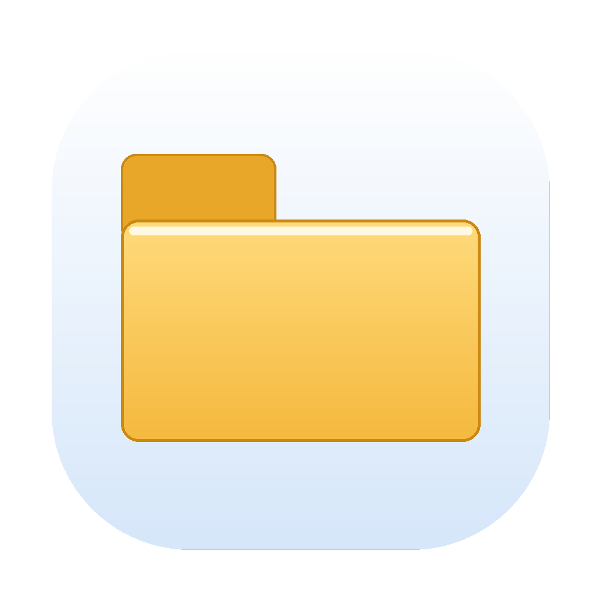
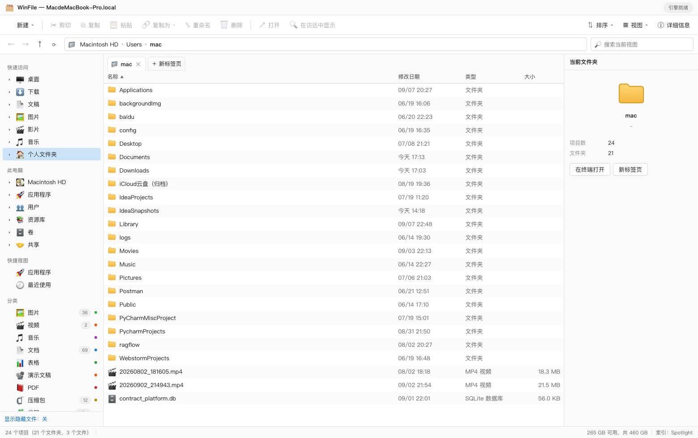
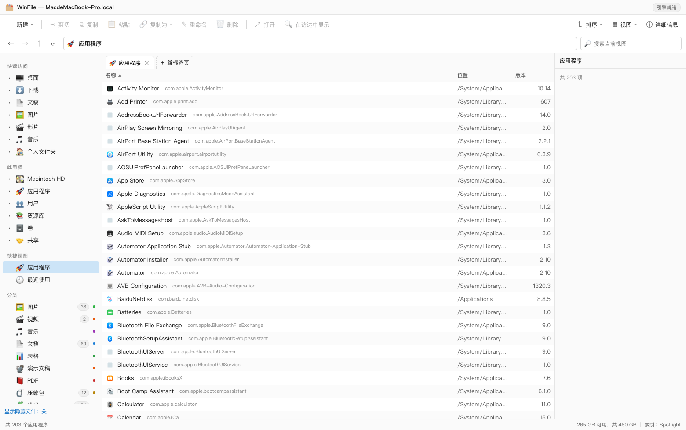
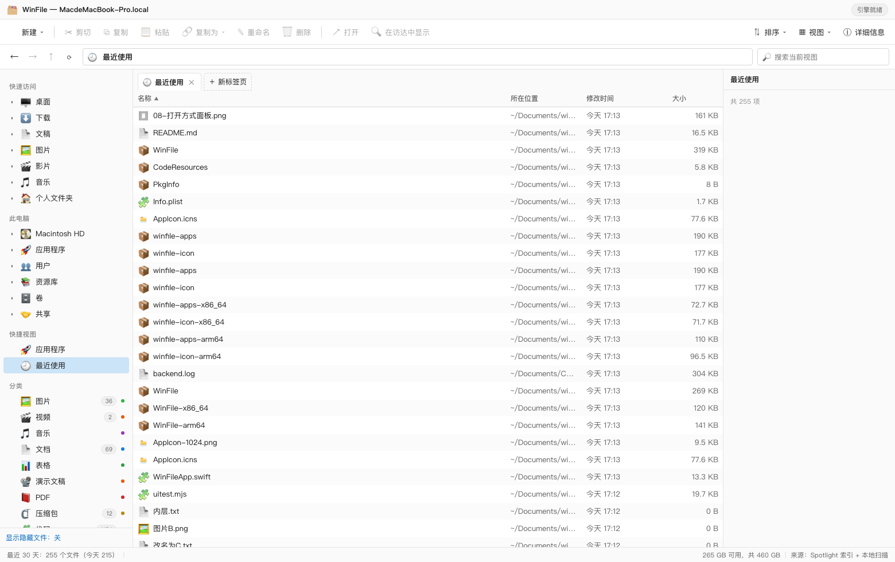
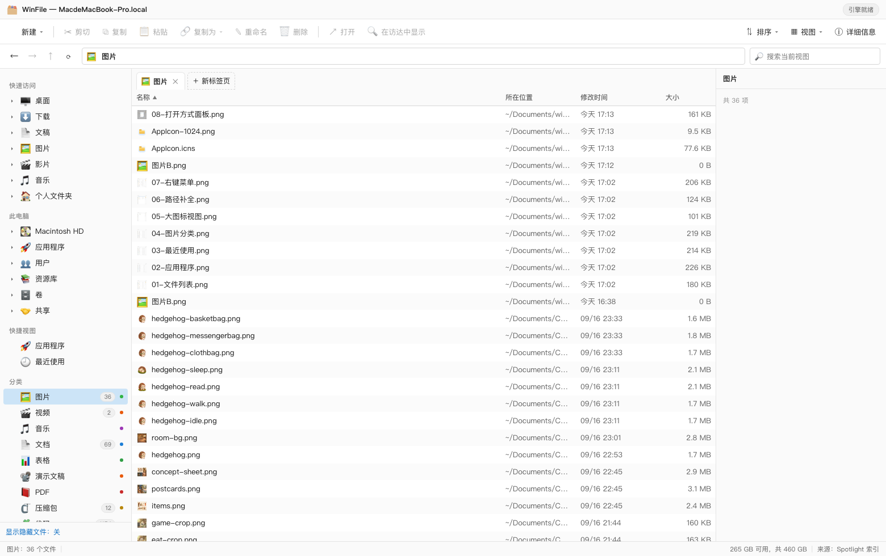
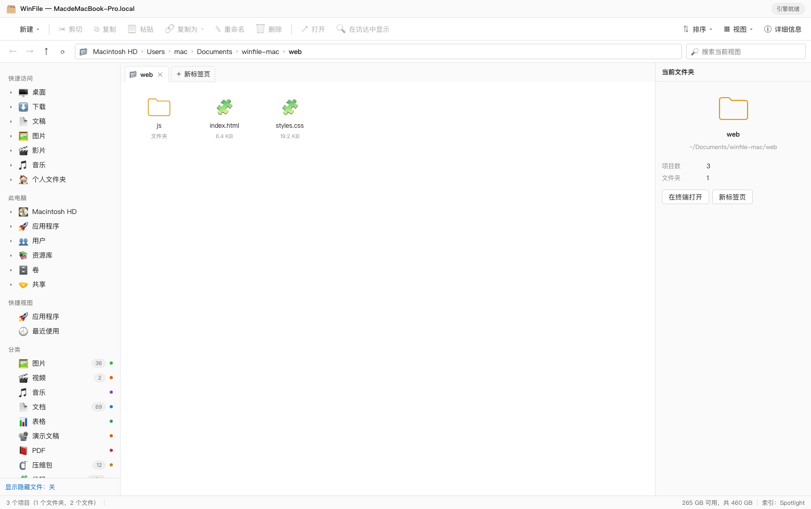
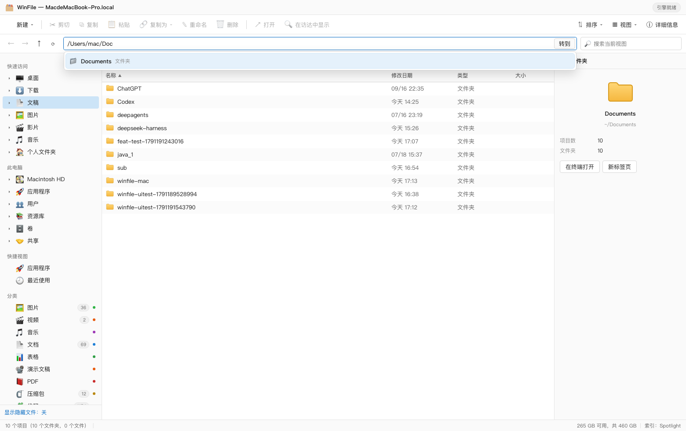
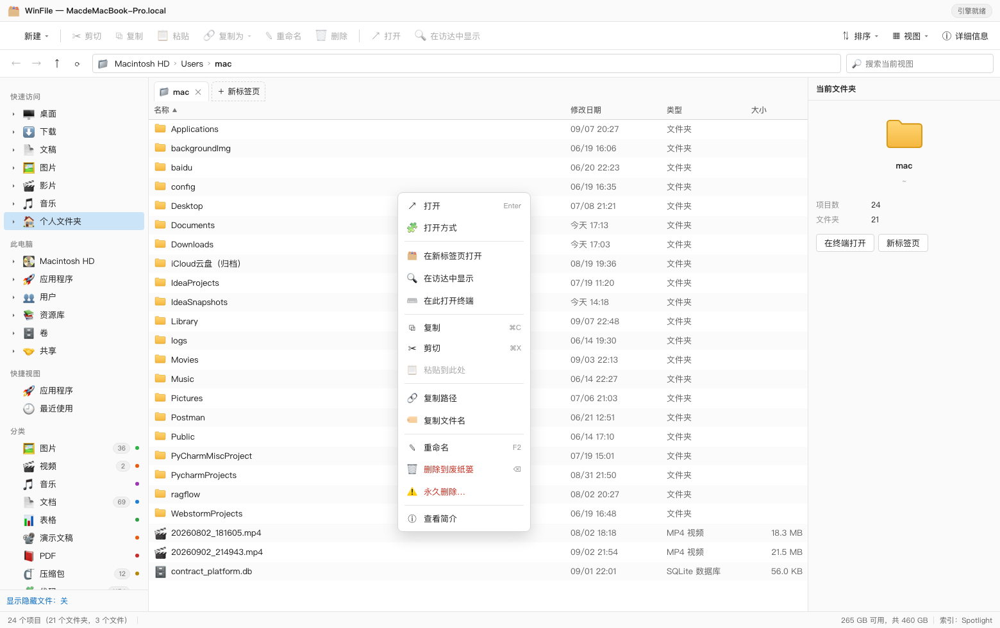
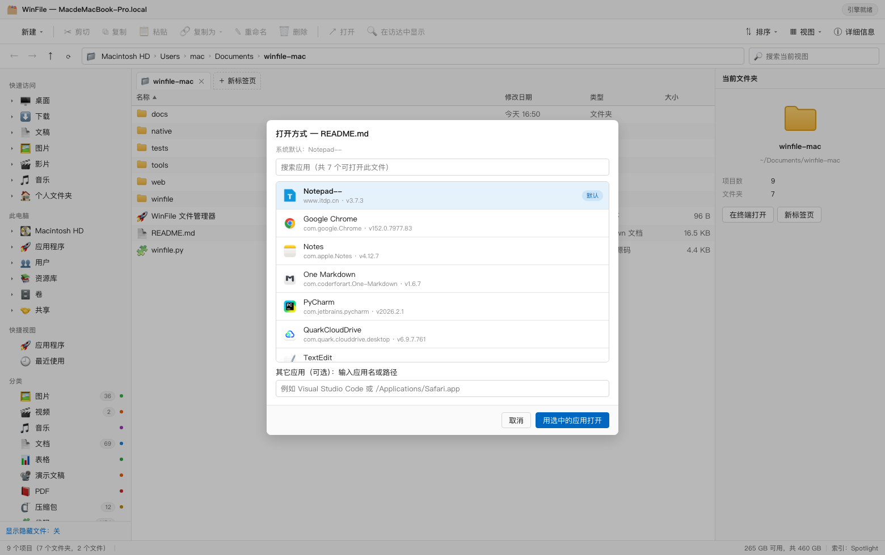

# WinFile — macOS 上的文件管理器（原生 SwiftUI 版）

Windows 资源管理器风格的 macOS 文件管理器。

> **v2 已完全重写为原生 SwiftUI 应用**：不再依赖 Python、不再启动 HTTP 服务、不再调用任何外部进程，
> 单一原生二进制。**本地使用形态**：未启用沙盒，可直接访问整个磁盘，
> 因此能够浏览其它应用的数据目录（见下方「应用数据」）。
>
> v1（Python + 网页界面）保留在 `winfile/` 与 `web/` 目录，仍然可用：
> `python3 winfile.py`。两者互不影响。



## 版本对照

| | v2 原生版（当前） | v1 网页版（保留） |
| --- | --- | --- |
| 界面 | 原生 SwiftUI | WKWebView 网页 |
| 后端 | Swift 原生 | Python 3 + HTTP 服务 |
| 依赖 | 无 | 系统 Python 3 |
| 磁盘访问 | 沙盒限制 | 全盘 |
| 体积 | 3.7 MB | Python 运行时 |
| 可上架 | 架构合规 | 不适用（本地使用） |
| 启动方式 | 双击 `WinFile.app` | `python3 winfile.py` |

---

## 1. 快速开始（v2 原生版）

```bash
cd ~/Documents/winfile-mac

# 本地版：全盘访问，适合自己用
./native/build_native.sh --in-place


open WinFile.app
```

构建脚本会自动：生成图标 → 编译 arm64 + x86_64 → 组装 bundle → 复制中英文本地化 →
按可用身份签名（无身份时用 ad-hoc，本机可运行）。

## 2. 功能

| 功能 | 说明 |
| --- | --- |
| **主页（Home）** | 对应 Windows 资源管理器首页：快速访问磁贴（桌面/下载/文稿/图片/影片/音乐/应用程序/个人文件夹）、收藏夹（可固定/取消固定）、**最近使用**（最近修改 + 应用内打开过，带「已打开」标记，可展开与清除记录） |
| **此电脑（This PC）** | 设备和驱动器：驱动器卡片带**容量进度条**（>75% 变橙、>90% 变红）、已用/可用/总容量、文件系统类型；右键可「获取信息 / 弹出（可移动盘）/ 在访达中打开 / 复制路径」；只读磁盘映像单独标注，不显示误导性的容量条 |
| **多页签** | 一个窗口内可开多个页签，每个页签有独立的目录、历史、排序与选择；页签栏支持点击切换、`+` 新建、`×` 关闭、右键「关闭其它/复制标签页」；工具栏「在新页签中打开文件夹」可一次选中多个文件夹各开一个页签。切换页签使用独立视图身份（`.id(tab.id)`），确保内容与侧边栏选中态都随页签正确切换 |
| Windows 风格界面 | 侧边栏（主页/此电脑/收藏/分类/位置/已授权）、页签栏、命令栏、面包屑地址栏、详细信息表格、大图标网格、检查器、状态栏 |
| 按类型分类 | 图片 / 视频 / 音乐 / 文档 / 表格 / 演示文稿 / PDF / 压缩包 / 代码 / 电子书 / 设计素材 / 数据库 / 字体 / 磁盘映像 / 可执行文件，带数量徽标 |
| 路径跳转与补全 | 双击地址栏输入路径，支持 `~`；输入即出现候选，`Tab` 补全、`↑↓` 选择、`Enter` 跳转 |
| 应用列表 | 聚合 `/Applications`、`/System/Applications` 等，原生 `NSWorkspace` 图标（含 Assets.car 中的系统应用） |
| 打开方式 | 原生 Launch Services 查询，列出可打开该文件的真实应用 + 默认标记 + 搜索过滤 |
| 复制文字 | ⌘C 复制文件的同时写入系统剪贴板；「复制为」可复制完整路径 / 文件名 / 所在目录 |
| 文件操作 | 打开、重命名、新建、制作副本、复制/剪切/粘贴、移到废纸篓（可撤销）、拖放 |
| **空白处右键菜单** | 在列表**空白区域**右键（对应 Windows 资源管理器行为）：新建文件夹/文本文档、把剪贴板文本存成文件、粘贴、排序方式（名称/日期/类型/大小 + 升/降序）、视图方式、显示隐藏文件、重新载入、在访达中显示当前文件夹、复制当前文件夹路径；主页与「此电脑」页各自也有对应菜单 |
| 搜索 | 在当前文件夹内递归按名称搜索 |
| 视图 | 详细信息（可排序）与大图标切换，隐藏文件开关 |
| 深色模式 | 完全使用系统语义颜色，自动跟随 |

## 3. 键盘快捷键

| 快捷键 | 功能 | 快捷键 | 功能 |
| --- | --- | --- | --- |
| `⌘C` / `⌘V` | 复制 / 粘贴文件（同时写入系统剪贴板） | `⌘⇧N` | 新建文件夹 |
| `⌘⌥C` | 复制完整路径 | `⌘D` | 制作副本 |
| `Return` | 重命名 | `⌘⌫` | 移到废纸篓 |
| `⌘[` / `⌘]` | 后退 / 前进 | `⌘↑` | 上一级文件夹 |
| `⌘T` | 新标签页 | `⌘W` | 关闭标签页 |
| `⌥⌘1` | 主页 | `⌥⌘2` | 此电脑 |
| `⌘⇧H` | 个人文件夹 | `⌘⇧A` | 应用程序 |
| `⌘⇧.` | 显示/隐藏隐藏文件 | `⌘,` | 设置 |

## 4. 测试

```bash
./native/run_native_tests.sh      # 172 项逻辑测试 + 页签切换冒烟测试（命令行 / 真实 bundle / 真实界面三种模式）

# 应用内置的三个验证入口：
./WinFile.app/Contents/MacOS/WinFile --run-tests              # 逻辑测试（172 项）
./WinFile.app/Contents/MacOS/WinFile --selftest-tabs out.txt    # 页签切换验证（真实界面像素比对）
./WinFile.app/Contents/MacOS/WinFile --render-snapshot out.png  # 界面快照（开发用，列表可能为空）

# v1 网页版测试（如果还在用）
python3 tests/test_api.py
node tools/uitest.mjs "http://127.0.0.1:8790/?token=<令牌>"
```

## 5. 项目结构

```
winfile-mac/
├── native/                       # v2 原生应用
│   ├── WinFile/                  #   SwiftUI 源码
│   │   ├── WinFileApp.swift      #   入口、菜单栏、命令
│   │   ├── MainView.swift        #   主界面（侧边栏/命令栏/地址栏/内容/检查器）
│   │   ├── SidebarView.swift     #   导航侧边栏
│   │   ├── FileViews.swift       #   表格与图标网格、原生图标
│   │   ├── InspectorView.swift   #   详细信息窗格
│   │   ├── HomeViews.swift       #   主页与此电脑两个页面
│   │   ├── TabManager.swift      #   多页签管理
│   │   ├── ContextMenuCatcher.swift #  空白处右键（AppKit 命中判定桥接）
│   │   ├── ClosureMenuItem.swift #   支持闭包动作的菜单项
│   │   ├── PlacesService.swift   #   快速访问/收藏夹/最近使用/驱动器
│   │   ├── Dialogs.swift         #   重命名/新建/打开方式/帮助
│   │   ├── SettingsView.swift    #   设置（通用/隐私授权/关于）
│   │   ├── PathField.swift       #   原生路径输入框（Tab 补全）
│   │   ├── Models.swift          #   条目模型与文件类型库
│   │   ├── FileSystemService.swift # 无状态文件 I/O（可后台执行）
│   │   ├── FSEngine.swift        #   常用文件夹、图标、废纸篓、Launch Services
│   │   ├── AppDataService.swift  #   应用数据目录扫描
│   │   ├── AppDataView.swift     #   应用数据页面
│   │   └── BrowserModel.swift    #   浏览状态（导航/排序/选择/剪贴板）
│   ├── WinFileTests/             #   逻辑测试套件（189 项）
│   ├── Resources/                #   zh-Hans / en 本地化
│   ├── native-Info.plist         #   应用元数据（含用途说明）
│   ├── build_native.sh           #   构建脚本（本地使用形态）
│   └── run_native_tests.sh       #   测试脚本
├── winfile/ web/ tools/ tests/   # v1 网页版（保留可用）
└── WinFile.app                   # 构建产物
```

## 6. 权限与访问范围（本地使用形态）

本应用为**本地使用形态**，未启用沙盒，可直接访问整个磁盘：

| 行为 | 结果 |
| --- | --- |
| 家目录与全盘 | 直接可读，无需授权 |
| 其它应用的数据目录 | 可读（见「应用数据」页）；系统保护的部分目录（如 Safari 容器）仍会被 macOS 拒绝 |
| 新建 / 重命名 / 复制 / 移动 / 制作副本 / 废纸篓 | 全部可用 |
| 图标提取、Launch Services「打开方式」 | 可用 |
| 递归防护（复制到自身） | 正常拒绝 |

> 说明：macOS 对**其它应用**的数据有 TCC 保护。极少数系统应用目录即使用户授予
> 「完整磁盘访问权限」仍不可读，此时界面会标注「无权限访问」，属系统限制。

## 7. 与沙盒的取舍（为什么不上架）

本项目最初按 App Store 上架标准开发（原生 SwiftUI、沙盒、无外部进程、无网络调用）。
后来明确以**本地使用**为唯一基准，原因是两者存在一个不可调和的冲突：

| 能力 | 本地使用形态 | 沙盒形态（上架） |
| --- | --- | --- |
| 浏览其它应用的数据（如微信文件） | ✅ 可用 | ❌ 系统禁止，永久不可实现 |
| App Store 分发 | ❌ 不适用 | ✅ 需付费会员（99 美元/年） |

由于「查看应用数据」是核心需求之一，项目选择本地使用形态，并已**移除全部沙盒代码**
（entitlements、安全作用域书签、授权流程），构建与运行只保留一种形态。

---

# 附录：v1 网页版文档

## 1. 快速开始

### 方式一：双击应用（推荐）

```bash
open ~/Documents/winfile-mac/WinFile.app
# 或直接在访达里双击 WinFile.app
```

首次启动会显示系统提示（因为是本地签名），选择"打开"即可。
需要重新构建或安装到「应用程序」文件夹：

```bash
./native/build_app.sh                    # 构建到 ~/Applications/WinFile.app
./native/build_app.sh --in-place         # 构建到项目目录下
```

`WinFile.app` 是**自包含**的：内部带有后端代码、前端页面与原生图标提取工具，
可以单独拷贝到任何位置（甚至别的 Mac）使用，不依赖项目目录。

### 方式二：命令行启动（开发/调试）

```bash
cd ~/Documents/winfile-mac
python3 winfile.py
```

浏览器会自动打开 `http://127.0.0.1:8790/?token=…`（带访问令牌的完整地址同时写入
`~/.winfile-mac/session.json`，端口会打印在终端里）。

常用参数：

```bash
python3 winfile.py --port 8888     # 换端口（端口被占用时会提示）
python3 winfile.py --no-browser    # 不自动打开浏览器，只启动服务
python3 winfile.py --check         # 环境自检（依赖、目录扫描、应用扫描、补全、最近使用）
python3 winfile.py --host 0.0.0.0  # 允许局域网访问（默认仅本机，需自行评估风险）
```

停止服务：在终端按 `Control + C`。

---

## 2. 界面说明

```
┌──────────────────────────────────────────────────────────────────────┐
│ 标题栏                                                     引擎状态   │
├──────────────────────────────────────────────────────────────────────┤
│ 新建 | 剪切 复制 粘贴 重命名 删除 | 打开 在访达中显示   排序 视图 详细信息 │
├──────────────────────────────────────────────────────────────────────┤
│ ← → ↑ ⟳ │ 面包屑 / 可编辑路径框 + 补全下拉 │        搜索当前视图        │
├────────────┬────────────────────────────────────────┬────────────────┤
│ 快速访问    │ 标签页                                  │  详细信息窗格   │
│ 桌面/下载…  │ 名称 │ 修改日期 │ 类型 │ 大小            │  预览与属性     │
│ 此电脑/卷   │ …                                      │  文件夹大小     │
│ 快捷视图    │                                        │  打开方式       │
│ 分类        │                                        │                │
├────────────┴────────────────────────────────────────┴────────────────┤
│ 状态栏：项目数 | 已选择 | 磁盘可用空间 | 数据来源                      │
└──────────────────────────────────────────────────────────────────────┘
```

### 导航窗格
- **快速访问**：桌面、下载、文稿、图片、影片、音乐、个人文件夹
- **此电脑**：Macintosh HD、应用程序、用户、资源库、卷、共享（含各卷剩余空间）
- **快捷视图**：应用程序、最近使用
- **分类**：图片 / 视频 / 音乐 / 文档 / 表格 / 演示文稿 / PDF / 压缩包 / 代码 / 字体 / 磁盘映像 / 数据库 / 电子书 / 设计素材 / 可执行文件（带数量徽标）
- 每个可展开项左侧的三角可以懒加载展开子文件夹（树形浏览）

### 地址栏（路径跳转与补全）
- 点击面包屑之间的空白或按 `⌘L` 进入编辑模式，直接输入路径后回车跳转
- 支持 `~`、`~/Documents`、`/Applications`、相对路径（相对当前用户家目录）
- 输入即出现补全下拉：`↑`/`↓` 选择、`Tab` 补全并继续深入、`Enter` 跳转、`Esc` 退出编辑
- 补全列表显示文件夹/文件图标、类型与匹配总数

### 视图
- **详细信息**：名称 / 修改日期 / 类型 / 大小，点击表头切换排序（文件夹始终排在前面）
- **大图标**：图片自动显示缩略图，文件夹使用黄色文件夹块
- 搜索框对当前视图做即时过滤（文件夹视图、最近使用、分类视图通用）

---

## 3. 核心功能

### 3.1 分类浏览
侧边栏「分类」按文件类型聚合全盘常用目录（桌面、文稿、下载、图片、影片、音乐、公共）中的文件，
数量徽标来自一次 Spotlight 查询后在内存中归类；点进去按修改时间倒序排列。
Spotlight 不可用（未索引目录、外置卷）时自动退回本地目录遍历。

### 3.2 最近使用
按最近修改时间列出最近 30 天使用过的文件，并给出「今天 / 本周 / 本月」计数。
数据来源是 **Spotlight 索引 + 本地目录扫描的并集**——这样既能覆盖全盘，也不会漏掉刚创建、
还没进索引的文件（状态栏会显示实际来源）。

### 3.3 应用程序
聚合 `/Applications`、`/Applications/Utilities`、`/System/Applications`、
`/System/Applications/Utilities`、`~/Applications`、`/System/Library/CoreServices`，
读取每个 `.app` 的 `Info.plist` 得到显示名、Bundle ID 与版本；图标由内置的 Swift 小工具
通过 `NSWorkspace` 提取成 128×128 PNG（缓存在 `~/.winfile-mac/icons`），因此**包括图标只存放在
`Assets.car` 里的系统应用**（日历、图书、计算器等）也能拿到真实图标。图标按需生成，
「应用程序」列表本身瞬间返回，不会等图标全部提取。双击即启动应用，右键可「显示包内容」。

### 3.4 文件操作
| 操作 | 入口 | 说明 |
| --- | --- | --- |
| 打开 | 双击 / `Enter` / 命令栏「打开」 | 交给系统默认应用（`open`） |
| 打开方式 | 详细信息窗格 / 右键菜单 | **可打开该文件的已装应用列表**（Launch Services 查询 + 真实图标 + 默认应用标记 + 搜索过滤），点选即用 |
| 在访达中显示 | 命令栏 / 右键 / `⌘` 点击项目 | `open -R` |
| 在此打开终端 | 右键 | 在该目录打开 Terminal |
| 新建 | 命令栏「新建」 | 新建文件夹 / 文本文档（重名自动加序号） |
| 重命名 | `F2` / 右键 | 对话框内默认只选中主文件名 |
| 复制 / 剪切 / 粘贴 | `⌘C` `⌘X` `⌘V` | 复制或移动到目标文件夹，重名自动加序号；**同时把文件路径写入系统剪贴板**，可直接粘到终端/编辑器；完成后提示"已复制「文件名」→「目标文件夹」"；会拒绝把文件夹放进它自己或它的子文件夹 |
| 复制为（文字） | 命令栏「复制为」/ 右键菜单 | 把**完整路径 / 文件名 / 所在目录 / 文件内容**写入系统剪贴板，跨应用粘贴 |
| 剪贴板文本存成文件 | 空白处右键 | 把系统剪贴板里的文字保存成当前文件夹下的新文件 |
| 删除 | `Delete` / 右键 | 默认移到废纸篓（通过 Finder，可撤销），也提供「永久删除」 |
| 拖拽 | 列表内拖放 | 拖到文件夹上或空背景处即可移动（按住 `Option` 为复制） |
| 多选 | `⇧` 连选、`⌘` 加选、`⌘A` 全选 | 详细信息窗格显示汇总大小 |
| 查看简介 | 右键 | 详细信息窗格显示路径、时间、大小、Bundle ID、链接目标 |

### 3.5 复制文字（系统剪贴板）

WinFile 里"复制"有两种用途，都支持：

| 想要 | 操作 | 结果 |
| --- | --- | --- |
| 复制**文件**到另一个文件夹 | 选中 → `⌘C` → 进入目标文件夹 → `⌘V` | 生成副本（同名自动加序号） |
| 复制**文字**（路径）到别处 | 选中 → `⌘C` | 文件路径进入系统剪贴板，可直接粘到终端、编辑器、聊天窗口 |
| 复制文件名 / 所在目录 | 命令栏「复制为」或右键菜单 | 只把文件名或所在目录写入剪贴板 |
| 复制**文件内容** | 选中文本文件 → 右键「复制文件内容」 | 整个文本内容进入剪贴板 |
| 把剪贴板文字变成文件 | 在文件夹空白处右键 →「剪贴板文本存成文件」 | 新建文件并写入剪贴板内容 |

> 二进制文件不会被当作文本复制（会明确提示"不是文本文件"），避免把乱码塞进剪贴板。

### 3.6 键盘快捷键
| 快捷键 | 功能 | 快捷键 | 功能 |
| --- | --- | --- | --- |
| `⌘L` | 编辑路径 | `F5` | 刷新 |
| `⌘C` / `⌘X` / `⌘V` | 复制 / 剪切 / 粘贴 | `F2` | 重命名 |
| `⌘A` | 全选 | `Delete` | 删除到废纸篓 |
| `⌘⇧N` | 新建文件夹 | `Backspace` | 返回上一级 |
| `⌘I` | 显示/隐藏详细信息窗格 | `Enter` | 打开选中项 |
| `⌥←` / `⌥→` | 后退 / 前进 | `⌥↑` | 上一级 |
| `↑` / `↓` | 移动选择 | `Esc` | 关闭菜单/退出编辑 |

---

## 4. 项目结构

```
winfile-mac/
├── winfile.py               # 启动入口（--port/--check/--no-browser）
├── winfile/                 # 后端包（Python 3，仅标准库）
│   ├── config.py            # 端口、令牌、状态目录、可访问根目录白名单
│   ├── extdb.py             # 文件类型数据库：扩展名 -> 分类/描述/图标/颜色
│   ├── utils.py             # 路径与格式化工具、外部命令、磁盘与目录大小
│   ├── fsscan.py            # 目录扫描与条目元数据（详细信息列）
│   ├── macrofs.py           # Spotlight、应用扫描、图标提取、最近使用、分类、文件操作
│   └── server.py            # HTTP 服务：静态前端 + JSON API + 令牌校验
├── web/                     # 前端（原生 ES Module，无构建）
│   ├── index.html           # 资源管理器布局
│   ├── styles.css           # Windows 11 风格样式
│   └── js/app.js            # 状态管理、渲染、交互、补全、右键菜单
├── WinFile.app              # 构建产物：可双击运行的原生应用（自包含）
├── native/                  # 原生外壳
│   ├── WinFileApp.swift     # Cocoa + WKWebView 外壳（启动并托管后端）
│   ├── winfile-icon.swift   # NSWorkspace 图标提取工具
│   ├── winfile-apps.swift   # Launch Services「打开方式」查询工具
│   ├── Info.plist           # 应用元信息
│   └── build_app.sh         # 一键构建 .app
├── tests/test_api.py        # v1 后端接口测试（81 项断言）
├── docs/screenshots/        # 界面截图
├── docs/icon/               # 应用图标（png + icns）
└── tools/                   # 开发期工具
    ├── shot_server.py       # 截图/自测用的服务实例
    ├── capture.mjs          # 用 Chrome DevTools Protocol 逐视图截图
    ├── uitest.mjs           # 浏览器内 UI 交互测试（33 项断言）
    ├── probe.mjs / diag.mjs # DOM 探针（排查渲染问题）
    └── shots.sh             # 一键生成截图
```

## 5. 接口一览

所有 `/api/*` 请求需要令牌：请求头 `X-Winfile-Token: <token>`（`` 等场景用 `?token=`）。

| 方法 | 路径 | 说明 |
| --- | --- | --- |
| GET | `/api/boot` | 启动信息：令牌、家目录、位置分组、分类、卷 |
| GET | `/api/files?path&sort&order&hidden&meta` | 目录列表 |
| GET | `/api/complete?q&limit` | 路径补全建议 |
| GET | `/api/apps?q&refresh` | 应用程序列表（含图标地址） |
| GET | `/api/recent?days&limit&refresh` | 最近使用 |
| GET | `/api/category?id&limit&refresh` | 按分类列出文件 |
| GET | `/api/categories?days&refresh` | 分类数量统计 |
| GET | `/api/tree?path` | 子文件夹树（懒加载） |
| GET | `/api/stat?paths` | 批量条目元数据（`\x1f` 分隔） |
| GET | `/api/folderinfo?path` | 文件夹递归大小 |
| GET | `/api/icon?key&app` · `/api/thumb?path&size` · `/api/content?path` | 应用图标 / 缩略图 / 文件内容 |
| GET | `/api/openers?path` | 可打开该文件的应用列表（默认应用 + 候选 + 图标） |
| GET · POST | `/api/clipboard` | 读取 / 写入系统剪贴板（文本、路径、文件名、目录、文件内容） |
| POST | `/api/savefile` | 把文本写入指定文件 |
| POST | `/api/open` `/api/reveal` `/api/rename` `/api/mkdir` `/api/newfile` `/api/delete` `/api/transfer` | 文件操作 |

## 6. 安全与隐私

- 服务只监听 `127.0.0.1`，其他设备无法访问（除非显式使用 `--host`）
- 每次启动生成随机访问令牌，令牌存于 `~/.winfile-mac/session.json`；数据接口一律校验令牌，
  防止其它网页在后台跨源读取你的文件
- 路径访问受白名单约束（家目录、`/`、`/Applications`、`/Volumes`、临时目录等），拒绝越界与非法路径
- 不含任何遥测或网络请求，所有操作都是本机命令调用

## 7. 测试与开发

```bash
python3 winfile.py --check                 # 环境与核心能力自检
python3 tests/test_api.py                  # v1 网页版后端接口测试（81 项断言）
node tools/uitest.mjs "http://127.0.0.1:8790/?token=<令牌>"   # UI 交互测试（59 项断言，含复制与打开方式）
./tools/shots.sh                           # 生成界面截图到 docs/screenshots
```

界面截图见 [`docs/screenshots/`](docs/screenshots)：

| 文件列表 | 应用程序 |
| --- | --- |
|  |  |

| 最近使用 | 图片分类 |
| --- | --- |
|  |  |

| 大图标视图 | 路径补全 |
| --- | --- |
|  |  |

| 右键菜单（含复制为 / 打开方式） | 打开方式：应用选择器 |
| --- | --- |
|  |  |

## 8. 已知限制

- **系统目录权限**：`~/Library` 下的部分目录、`/System` 等受 macOS 隐私保护，会提示「没有权限访问」。
  需要时请在「系统设置 → 隐私与安全性 → 完全磁盘访问权限」中授权运行终端（或浏览器）后重试。
- **分类/最近使用的范围**：默认只索引桌面、文稿、下载、图片、影片、音乐、公共这些常用目录，
  不是整盘扫描（整盘扫描太慢）。如需扩展，可设置 `WINFILE_SCAN_ROOTS`（冒号分隔的目录列表）。
- **Spotlight 依赖**：若某个卷关闭了索引，该卷的文件不会出现在分类/最近使用中，此时走本地遍历兜底。
- **文件夹大小**：大目录为控制耗时会有 4 秒预算，结果显示「部分统计」。
- **应用为 ad-hoc 签名**：首次打开需在「系统设置 → 隐私与安全性」里点"仍要打开"；
  如需彻底免提示，可自行用开发者证书重签。
- 应用依赖系统 Python 3（`/usr/local/bin/python3`、Homebrew 或系统自带），未做 Python 运行时内置。
- 未实现：压缩/解压、标签颜色、网络位置浏览、批量重命名。
